<div align="center">

```text
 __  __ ___ _   _ ___ _____ _____ _
|  \/  |_ _| \ | |_ _|_   _| ____| |
| |\/| || ||  \| || |  | | |  _| | |
| |  | || || |\  || |  | | | |___| |___
|_|  |_|___|_| \_|___| |_| |_____|_____|

        M A G I S   C L U B
   + COPROCESSEUR RASPBERRY PI
```

# MINITEL MAGIS CLUB
## Guide de l'utilisateur et manuel de référence technique du système

**Système d'exploitation télématique · Minitel Magis Club en 80 colonnes · Coprocesseur Raspberry Pi**

*Édition 2026 — Révision 5.1*

</div>

<p align="center">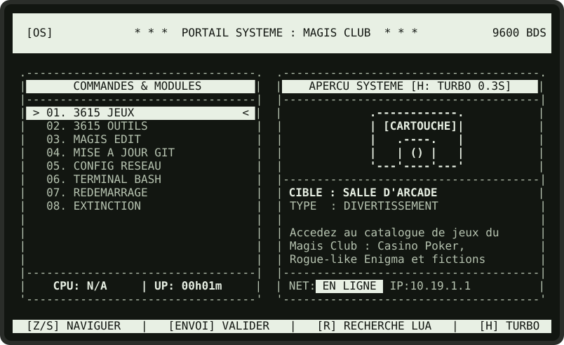</p>

---

### Avant-propos

Félicitations. Vous venez de mettre en service un **Minitel Magis Club** équipé de son coprocesseur : un système d'exploitation complet qui transforme ce terminal de la fin des années 1990 en micro-ordinateur moderne. Il offre un portail de lancement, une salle d'arcade, un tableur et un traitement de texte. Il comprend aussi un langage BASIC avec entrées-sorties matérielles, et l'accès en direct aux services d'Internet : horaires de trains, prix des carburants, itinéraires, messagerie.

Le **Magis Club** est l'un des derniers et des plus évolués des Minitel. Construit par Alcatel pour France Télécom, il fonctionne en 80 colonnes et sa liaison série atteint 9600 bauds. Sa prise péri-informatique à **8 broches** transporte, en plus des données, un **signal audio**. Le système que décrit ce manuel tire parti de tout cela.

Le Minitel reste ce qu'il a toujours été : un **terminal**, c'est-à-dire un écran, un clavier et un haut-parleur. Toute l'intelligence est logée dans un petit ordinateur Raspberry Pi caché derrière lui, relié par un simple câble. Le Raspberry Pi calcule, le Minitel affiche et sonne.

Ce manuel est écrit dans la tradition des grands guides de référence des micro-ordinateurs 8 bits. Il ne se contente pas de dire *quelle touche presser* : il explique *pourquoi* et *comment cela fonctionne*, du brochage de la prise péri-informatique jusqu'aux séquences d'échappement envoyées à l'écran. Lisez les deux premiers chapitres pour démarrer, puis piochez dans le reste selon vos envies.

Un second volume, le **[Manuel de programmation MICRO-BASIC](docs/MANUEL_BASIC.md)**, est entièrement consacré au langage BASIC intégré.

> **À propos des illustrations.** Toutes les copies d'écran de ce manuel sont **authentiques** : chaque programme a été réellement exécuté, et l'image reproduit, caractère par caractère, ce qu'il a envoyé à l'écran 80 × 24 (vidéo inverse et gras compris). Elles ont été réalisées en mode émulation PC : c'est pourquoi la température du processeur y apparaît parfois comme `N/A`.

> **Impression.** Ce document est prévu pour être lu à l'écran comme imprimé. Les deux manuels existent en PDF au format A4, prêts à imprimer, dans la release **[Manuels PDF](https://github.com/fauwzk/minitel_gc/releases/tag/manuels)** du dépôt. Une action GitHub les régénère à chaque commit qui modifie la documentation (script `outils/manuels_pdf.py`), et ces liens donnent toujours la dernière version : [Manuel_Minitel_Magis_Club.pdf](https://github.com/fauwzk/minitel_gc/releases/download/manuels/Manuel_Minitel_Magis_Club.pdf) et [Manuel_MICRO-BASIC.pdf](https://github.com/fauwzk/minitel_gc/releases/download/manuels/Manuel_MICRO-BASIC.pdf).

<div style="page-break-after: always;"></div>

## TABLE DES MATIÈRES

| Chapitre | Titre | Contenu |
| :------: | :---- | :------ |
| **1** | [Mise en service](#chapitre-1--mise-en-service) | Matériel requis, câblage de la prise DIN 8, installation, premier démarrage |
| **2** | [Le matériel](#chapitre-2--le-matériel) | Liaison série, clavier, écran VT100, son et audio, fiche technique |
| **3** | [L'architecture logicielle](#chapitre-3--larchitecture-logicielle) | Démarrage, arborescence, portail, lanceurs, mises à jour |
| **4** | [Le moteur graphique et le SDK](#chapitre-4--le-moteur-graphique-et-le-sdk-minitellua) | Delta-drawing, framebuffer, référence de `minitel.lua` |
| **5** | [Les logiciels du poste de travail](#chapitre-5--les-logiciels-du-poste-de-travail-utils) | Éditeur, tableur, télématique, santé, musique |
| **6** | [La salle d'arcade](#chapitre-6--la-salle-darcade-jeux) | Les 15 cartouches de jeux |
| **7** | [Le langage MICRO-BASIC](#chapitre-7--le-langage-micro-basic) | Présentation et renvoi au second manuel |
| **8** | [Guide du développeur](#chapitre-8--guide-du-développeur) | Écrire sa propre cartouche Lua |
| **A** | [Mémento VT100](#annexe-a--mémento-des-séquences-vt100) | Les séquences d'échappement utilisées |
| **B** | [Codes clavier](#annexe-b--codes-clavier) | Ce que renvoie chaque touche |
| **C** | [Dépannage](#annexe-c--dépannage) | Problèmes courants et solutions |
| **D** | [Glossaire](#annexe-d--glossaire) | Vocabulaire télématique |
| **E** | [Références](#annexe-e--références) | Sources sur le matériel du Magis Club |

<div style="page-break-after: always;"></div>

## CHAPITRE 1 : MISE EN SERVICE

### 1.1 Le matériel nécessaire

| Élément | Rôle | Remarques |
| :------ | :--- | :-------- |
| **Minitel Magis Club** | Écran, clavier, haut-parleur | Le terminal pour lequel le système est conçu. Les autres Minitel capables de passer en 80 colonnes (prise DIN 5 broches) fonctionnent aussi, mais sans la liaison audio. |
| **Raspberry Pi** | Unité centrale | N'importe quel modèle capable de faire tourner Raspberry Pi OS et Lua 5.3. Un Pi 3 ou 4 est confortable. |
| **Convertisseur USB ↔ série TTL** | Liaison des données | Apparaît sous Linux comme `/dev/ttyUSB0`. |
| **Fiche DIN mâle à 8 broches** | Prise péri-informatique | Le connecteur rond à l'arrière du Magis Club. Une fiche DIN 5 broches s'y enfiche aussi, mais elle ne donne accès ni à l'audio ni à l'alimentation. |
| **Câble audio** (fiche jack 3,5 mm) | Liaison audio | De la sortie audio du Raspberry Pi vers les broches audio de la prise (§ 2.6). |
| **Carte micro-SD** (8 Go et plus) | Stockage | Système, programmes, sauvegardes. |
| **Connexion réseau** (facultative) | Services en ligne et mises à jour | Wi-Fi ou Ethernet. Le système fonctionne aussi hors ligne. |

### 1.2 La prise péri-informatique du Magis Club

Les premiers Minitel avaient une prise péri-informatique à 5 broches. Le Magis Club reprend ces 5 broches, à la même place, et en **ajoute trois** pour une **interface audio**. On y trouve donc, sur une seule prise :

* la **liaison série** des données, en niveaux logiques **TTL 5 V**, et non en RS-232. Ne la reliez jamais directement à un vieux port série de PC (±12 V) ;
* une **alimentation** non régulée pour un périphérique ;
* une **voie audio** dans chaque sens, reliée au circuit téléphonique du Minitel.

| Broche | Signal | Sens (vu du Minitel) | Usage dans ce système |
| :----: | :----- | :------------------- | :-------------------- |
| **1** | RX — réception des données | Entrée | ← TX du convertisseur USB |
| **2** | Masse des données (0 V) | — | ↔ GND du convertisseur |
| **3** | TX — émission des données | Sortie | → RX du convertisseur |
| **4** | Indicateur de transmission | Sortie | Non utilisée |
| **5** | Alimentation 8,5 V, 1 A, non régulée (environ 12 V à vide) | Sortie | Non utilisée (voir l'encadré) |
| **6** | RX audio — audio reçu par le Minitel | Entrée | ← Sortie audio du Raspberry Pi (§ 2.6) |
| **7** | TX audio — audio émis par le Minitel | Sortie | Facultatif : vers une entrée micro |
| **8** | Masse audio | — | ↔ Masse de la prise jack |

```text
              CABLAGE DE LA PRISE PERI-INFORMATIQUE (DIN 8)

    MINITEL MAGIS CLUB                      RASPBERRY PI
    ------------------                      ------------
                                     .---- Convertisseur USB-serie TTL ---.
    Broche 3 (TX donnees) -------------->  RX                               |
    Broche 1 (RX donnees) <--------------  TX                 USB --> Pi    |
    Broche 2 (masse)      ---------------  GND                              |
                                     '------------------------------------'
                                     .---- Sortie audio (jack 3,5 mm) ----.
    Broche 6 (RX audio)   <--[ R ]--||--  Pointe (canal gauche)            |
    Broche 8 (masse audio) -------------  Corps (masse)                    |
                                     '------------------------------------'
    Broche 7 (TX audio)   --------------> (facultatif) entree micro
                                          d'une carte son USB

    R  : resistance d'attenuation (quelques kilo-ohms, voir 2.6)
    || : condensateur de liaison (1 a 10 microfarads)
```

> **ATTENTION.** Ce brochage est celui relevé sur un Magis Club révision 2 (voir l'[annexe E](#annexe-e--références)). La numérotation diffère d'une documentation à l'autre, et elle est moulée sur la fiche DIN elle-même : **vérifiez chaque broche à l'ohmmètre ou à l'oscilloscope avant de souder**. La sortie TX du Minitel est généralement à **collecteur ouvert** : si votre convertisseur ne voit rien arriver, ajoutez une résistance de rappel (environ 10 kΩ) entre la broche 3 et la tension logique du convertisseur.

> **L'alimentation de la broche 5.** Elle délivre environ 8,5 V sous 1 A, non régulés, et monte vers 12 V à vide. Elle ne doit **jamais** être reliée directement au Raspberry Pi, qui exige 5 V régulés. Même à travers un régulateur 5 V, ses quelque 8 W ne suffisent pas à un Raspberry Pi 4. Ce système ne s'en sert pas.

Le convertisseur se branche ensuite sur un port USB du Raspberry Pi. Linux le nomme `/dev/ttyUSB0`.

### 1.3 L'installation du logiciel

Sur un Raspberry Pi fraîchement installé (Raspberry Pi OS), récupérez le script d'installation du dépôt et lancez-le en super-utilisateur :

```bash
sudo ./install_minitel.sh
```

Le script `install_minitel.sh` déroule huit étapes. Comprendre ce qu'il fait vous aidera en cas de panne :

| Étape | Action | Détail technique |
| :---: | :----- | :--------------- |
| **1** | Dépendances | `apt-get install lua5.3 git sox alsa-utils network-manager coreutils` |
| **2** | Utilisateur `minitel` | Création du compte, ajout aux groupes `dialout` (port série), `audio`, `video`, `plugdev`. **Le mot de passe est supprimé** pour permettre la connexion automatique. |
| **3** | Droits `sudo` | Le compte `minitel` peut lancer `reboot` et `poweroff` sans mot de passe, et rien d'autre (`/etc/sudoers.d/010_minitel`). |
| **4** | Clonage du dépôt | `git clone` dans `/home/minitel/minitel_gc`. |
| **5** | Connexion automatique | Un service `serial-getty@ttyUSB0` ouvre une session `minitel` sur le port série, à 9600 bauds, avec le type de terminal `vt100`. |
| **6** | Profil de session | `~/.bash_profile` : si la session arrive par `/dev/ttyUSB0`, il se place dans le dépôt et lance `lua5.3 master.lua`. |
| **7** | Démarrage silencieux | Retire la console série du noyau de `cmdline.txt` et ajoute `quiet splash` : les messages de démarrage de Linux ne polluent plus l'écran du Minitel. |
| **8** | Volume audio | Règle les mixeurs ALSA à 85 %. Pour la voie audio du Magis Club, ce niveau est souvent trop fort (§ 2.6). |

Redémarrez ensuite le Raspberry Pi (`sudo reboot`).

> **Sécurité.** Le compte `minitel` n'a pas de mot de passe et le menu du portail donne accès à un terminal Bash. Quiconque a le Minitel sous la main a donc la main sur le Raspberry Pi. N'exposez pas ce Raspberry Pi sur Internet (pas de redirection de port SSH vers lui, par exemple).

### 1.4 Le premier démarrage (démarrage à froid)

À la mise sous tension, un Minitel démarre en **mode Vidéotex** : 40 colonnes, jeu de caractères Télétel, et il ne comprend pas les séquences VT100 qu'envoie le système. Le portail affiche donc d'abord un écran d'instructions volontairement très simple, lisible même en 40 colonnes :

<p align="center">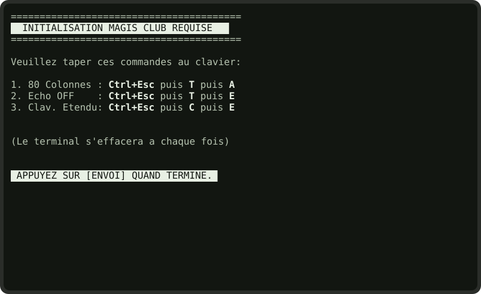<br><sub><b>Fig. 1.1</b> — L'écran d'initialisation à froid, redessiné chaque seconde.</sub></p>

Tapez au clavier du Minitel les trois combinaisons indiquées. L'écran s'efface après chacune :

| N° | Combinaison | Effet |
| :-: | :---------- | :---- |
| 1 | `Ctrl` + `Esc`, puis `T`, puis `A` | Passage en **mode téléinformatique ASCII** : 80 colonnes, émulation VT100. |
| 2 | `Ctrl` + `Esc`, puis `T`, puis `E` | **Écho local coupé** : les touches frappées ne s'affichent plus d'elles-mêmes, c'est le Raspberry Pi qui décide quoi afficher. |
| 3 | `Ctrl` + `Esc`, puis `C`, puis `E` | **Clavier étendu** : les flèches et les touches de fonction envoient des séquences VT100. |

Appuyez ensuite sur **`[ENVOI]`**. Le portail :

1. crée le fichier témoin `/tmp/minitel_warmboot` (il disparaît à l'extinction du Pi) ;
2. teste la connexion Internet (un `ping` vers `1.1.1.1`) ;
3. **si le réseau répond**, lance d'abord le programme de mise à jour (voir § 3.5), puis revient au portail ;
4. sinon, affiche directement le portail.

Tant que le Raspberry Pi reste allumé, les sessions suivantes trouvent `/tmp/minitel_warmboot` et sautent l'écran d'initialisation : c'est le **démarrage à chaud**.

> **Vitesse de la liaison.** Le système dialogue à **9600 bauds, 8 bits**. Le port série du Magis Club fonctionne soit en 1200 bauds 7 bits, soit en 9600 bauds 8 bits ; le choix se fait par logiciel. Le Minitel et le Raspberry Pi doivent être réglés sur la même vitesse, sinon l'écran se remplit de caractères incohérents.

### 1.5 Le mode émulation PC

Tout le système fonctionne aussi **sans Minitel**, dans le terminal d'un ordinateur Linux ou macOS. Au démarrage, la bibliothèque `minitel.lua` cherche `/dev/ttyUSB0` ; si elle ne le trouve pas, elle bascule d'elle-même en mode PC et utilise le terminal courant.

```bash
cd minitel_gc
lua5.3 master.lua
```

Réglez votre terminal sur **80 colonnes × 24 lignes**. Le mode PC est idéal pour développer et tester une cartouche avant de la lancer sur le vrai Minitel.

<div style="page-break-after: always;"></div>

## CHAPITRE 2 : LE MATÉRIEL

### 2.1 Vue d'ensemble : un terminal et son unité centrale

```text
+--------------------------+   Prise DIN 8 broches  +----------------------------+
|  MINITEL MAGIS CLUB      |                        |  UNITE CENTRALE LINUX      |
|                          |  DONNEES (1-2-3)       |  (RASPBERRY PI)            |
|  Ecran 80 x 24 (VT100)   | <====================> |  USB : convertisseur serie |
|  Clavier etendu (ESC)    |  9600 bauds, 8N1, TTL  |  serial-getty (autologin)  |
|  Echo local coupe        |                        |  Lua 5.3 + minitel.lua     |
|                          |  AUDIO (6-8)           |                            |
|  Haut-parleur interne    | <--------------------- |  Sortie jack : SoX (son)   |
|                          |                        |  GPIO (BASIC)              |
+--------------------------+                        +----------------------------+
  affiche, transmet, sonne                               calcule et decide
```

Le partage des rôles est strict :

* le **Minitel** n'exécute aucun programme. Il affiche les caractères qu'il reçoit, transmet les touches frappées et diffuse sur son haut-parleur le son qui arrive par la voie audio ;
* le **Raspberry Pi** exécute tout : système, jeux, BASIC, accès réseau, synthèse sonore. Il ne voit le Minitel qu'au travers d'un flux d'octets dans chaque sens, plus un signal audio.

Conséquence directe : **la vitesse de la liaison série est la ressource la plus précieuse du système.** C'est elle, et non le processeur, qui limite la fluidité de l'affichage (voir chapitre 4).

### 2.2 La liaison série

| Paramètre | Valeur | Signification |
| :-------- | :----- | :------------ |
| Débit | **9600 bauds** | 9600 bits par seconde sur le fil. |
| Format | **8N1** | 8 bits de données, aucune parité, 1 bit d'arrêt. |
| Coût d'un caractère | 10 bits | 1 bit de départ + 8 bits + 1 bit d'arrêt. |
| Débit utile | **960 caractères par seconde** | Soit environ 1 ms par caractère. |
| Périphérique Linux | `/dev/ttyUSB0` | Le convertisseur USB-série. |

Au lancement de chaque programme, `minitel.init()` configure le port avec la commande :

```bash
stty -F /dev/ttyUSB0 9600 cs8 -parenb -cstopb raw -echo -icanon min 0 time 0
```

| Option `stty` | Effet |
| :------------ | :---- |
| `9600 cs8 -parenb -cstopb` | Débit 9600, 8 bits, pas de parité, 1 bit d'arrêt. |
| `raw` et `-icanon` | Pas de mise en tampon par ligne : chaque octet est disponible dès sa réception, sans attendre `[ENVOI]`. |
| `-echo` | Linux ne renvoie pas les caractères reçus. |
| `min 0 time 0` | **Lecture non bloquante** : lire un octet alors qu'aucune touche n'a été frappée rend immédiatement « rien ». |

La lecture non bloquante est la clé de tous les programmes animés : la boucle principale d'un jeu interroge le clavier, et si rien n'est arrivé, elle continue d'animer l'écran au lieu de rester figée.

À la sortie, `minitel.cleanup()` remet le terminal en état normal (`stty sane`), réaffiche le curseur et efface l'écran.

### 2.3 Le clavier

Une touche ordinaire (lettre, chiffre, ponctuation) envoie **un seul octet**, son code ASCII. Les touches spéciales du Minitel et les flèches envoient une **séquence d'échappement** : l'octet `ESC` (code 27, `\x1b`) suivi de deux ou trois caractères.

À 9600 bauds, les octets d'une même séquence arrivent à environ une milliseconde d'intervalle. La fonction `minitel.get_key()` lit le premier octet ; si c'est `ESC`, elle attend activement les suivants (jusqu'à 50 000 tentatives de lecture) pour reconstituer la séquence complète, puis renvoie un **nom de touche** lisible. Si rien ne suit le `ESC`, c'est la touche Échap seule : elle est traduite en `"RETOUR"`.

| Touche (Minitel ou PC) | Séquence reçue | Nom renvoyé par `get_key()` |
| :--------------------- | :------------- | :-------------------------- |
| Flèches ↑ ↓ → ← | `ESC [A` `ESC [B` `ESC [C` `ESC [D` | `"UP"` `"DOWN"` `"RIGHT"` `"LEFT"` |
| Début / Fin | `ESC [H` / `ESC [F` | `"HOME"` / `"END"` |
| Page précédente / suivante | `ESC [5~` / `ESC [6~` | `"PAGE_UP"` / `"PAGE_DOWN"` |
| **`[ENVOI]`** (ou Entrée) | `ESC OM` ou `\r` ou `\n` | `"ENVOI"` |
| **`[RETOUR]`** (ou Échap, F3) | `ESC OR`, `ESC [13~` ou `ESC` seul | `"RETOUR"` |
| **`[CORRECTION]`** (ou Retour arrière, Suppr) | `ESC Ol`, `ESC [3~`, `\x7f` ou `\x08` | `"CORRECTION"` |
| **`[ANNULATION]`** (ou F2) | `ESC OQ` / `ESC [12~` | `"ANNULATION"` |
| **`[SOMMAIRE]`** (ou F1) | `ESC OP` / `ESC [11~` | `"SOMMAIRE"` |
| **`[REPETITION]`** (ou F4) | `ESC OS` / `ESC [14~` | `"REPETITION"` |
| **`[GUIDE]`** | `ESC Om` | `"GUIDE"` |
| **`[SUITE]`** | `ESC On` | `"SUITE"` |
| **Impression**, F12 ou `Ctrl`+`P` | `ESC [i`, `ESC [0i`, `ESC [24~` ou `\x10` | Capture d'écran (voir § 3.7), puis `"REPETITION"` |
| Toute autre touche | Son code ASCII | Le caractère lui-même (`"a"`, `"Z"`, `" "`…) |

> **Convention du système.** La touche **`[REPETITION]`** sert partout à **redessiner l'écran complet**. Si une perturbation de la ligne a laissé des caractères parasites, appuyez dessus.

Beaucoup de programmes acceptent aussi les touches **`Z` `Q` `S` `D`** à la place des flèches (disposition AZERTY), car les flèches du Minitel ne fonctionnent qu'en mode clavier étendu.

### 2.4 L'écran

Le Magis Club possède un tube cathodique en **niveaux de gris** ; en mode Vidéotex, il sait même afficher des photographies. En mode téléinformatique, celui qu'utilise le système, il se comporte comme un terminal **DEC VT100** réduit à l'essentiel :

| Caractéristique | Valeur |
| :-------------- | :----- |
| Résolution texte | **80 colonnes × 24 lignes** |
| Couleurs | Monochrome (le système n'utilise pas les niveaux de gris) |
| Attributs utilisés | **Vidéo inverse** (`ESC[7m`), **gras / surbrillance** (`ESC[1m`) |
| Jeu de caractères | ASCII 7 bits (32 à 126). **Pas d'accents** : les programmes les retirent avec `minitel.clean_accents()`. |
| Origine des coordonnées | Ligne 1, colonne 1 en haut à gauche |

Le système pilote l'écran exclusivement par **séquences d'échappement** : positionner le curseur, effacer, passer en vidéo inverse, définir une zone de défilement. La liste complète figure en [annexe A](#annexe-a--mémento-des-séquences-vt100).

Par convention, tous les programmes du système partagent la même mise en page :

```text
 Ligne  1   +================================================+  <- bandeau
 Ligne  2   | [SYS]    * * *  TITRE DU PROGRAMME  * * *      |     en video
 Ligne  3   +================================================+     inverse
 Ligne  4
 Lignes 5   .----------------.  .--------------------------.
   a   22   | zone de travail|  | details / apercu         |  <- cadres ASCII
            '----------------'  '--------------------------'
 Ligne 23
 Ligne 24   [Z/S] CHOIX | [ENVOI] VALIDER | [RETOUR] MENU     <- touches
```

### 2.5 La synthèse sonore

Le Minitel ne sait pas fabriquer de musique : le son est **synthétisé par le Raspberry Pi**, avec le synthétiseur en ligne de commande **SoX** (commande `play`), puis envoyé au haut-parleur du Minitel par la voie audio de la prise péri-informatique (§ 2.6). La fonction `minitel.play_sound(effet)` lance `play` **en tâche de fond**, si bien que le programme continue de tourner pendant que le son est joué.

| Effet demandé | Forme d'onde | Durée | Fréquence |
| :------------ | :----------- | :---- | :-------- |
| `"hit"` (et tout nom inconnu) | Carrée | 0,05 s | 880 Hz (bip) |
| `"win"`, `"pickup"` | Carrée | 0,15 s | Glissando montant 440 → 1200 Hz |
| `"lose"`, `"damage"` | Dent de scie | 0,3 s | Glissando descendant 300 → 100 Hz |

Si SoX n'est pas installé, les sons sont simplement ignorés. Le séquenceur **3615 PROTRACKER** (§ 5.6) pousse SoX bien plus loin : il mixe en temps réel trois voix mélodiques et une boîte à rythmes. L'instruction `BEEP` du MICRO-BASIC joue l'effet `"hit"`.

### 2.6 La voie audio du Magis Club

**Ce qu'elle est.** Les broches 6, 7 et 8 de la prise péri-informatique forment une **interface audio**, prévue par Alcatel pour recevoir et émettre des signaux de parole entre un périphérique et la **ligne téléphonique** du Minitel :

| Broche | Signal | Sens |
| :----: | :----- | :--- |
| **6** | RX audio | Vers le Minitel : audio reçu |
| **7** | TX audio | Depuis le Minitel : audio émis |
| **8** | Masse audio | Référence des deux voies |

Le Magis Club possède un **haut-parleur interne**, celui qui fait entendre la numérotation et les tonalités de la ligne. Le système s'en sert pour diffuser son propre son : la sortie audio du Raspberry Pi est injectée sur la broche 6, et les effets sonores, la musique du PROTRACKER et les `BEEP` du BASIC sortent **du Minitel lui-même**, sans haut-parleur supplémentaire.

> **Ce que dit la documentation, et ce qu'elle ne dit pas.** Le rôle des trois broches et leur numérotation proviennent de la fiche du constructeur et de relevés de collectionneurs ([annexe E](#annexe-e--références)). Les **niveaux électriques** attendus ne sont publiés nulle part, et le sens RX / TX est donné ici dans la même convention que la broche 1 (RX = ce que reçoit le Minitel). Montez donc le circuit ci-dessous **avec un volume faible**, et augmentez-le progressivement.

**Le montage.** La sortie casque du Raspberry Pi (prise jack 3,5 mm) délivre un signal stéréo d'environ 1 V, avec une composante continue. On le ramène en mono, on bloque le continu et on l'atténue :

```text
   JACK 3,5 mm DU RASPBERRY PI                         PRISE DIN DU MAGIS CLUB

   Pointe (canal gauche) ---[ 1 kohm ]---+
                                         +---||---[ 10 kohm ]---- Broche 6 (RX audio)
   Anneau (canal droit)  ---[ 1 kohm ]---+   10 uF
                                                    (reglage du niveau)
   Corps (masse) -------------------------------------------- Broche 8 (masse audio)
```

| Composant | Rôle |
| :-------- | :--- |
| Deux résistances de 1 kΩ | Mélangent les canaux gauche et droit en mono, sans les court-circuiter l'un sur l'autre. |
| Condensateur de 10 µF (non polarisé, ou chimique, pôle + côté Pi) | Laisse passer le son et bloque la tension continue. |
| Résistance de 10 kΩ, ou potentiomètre de 10 kΩ | Atténue le signal. Réduisez-la si le son est trop faible, augmentez-la s'il sature. |

**Les réglages côté Raspberry Pi.** Le son est géré par ALSA. Le profil de session exporte `AUDIODRIVER=alsa` pour que SoX l'utilise.

1. Dirigez le son vers la prise jack : `sudo raspi-config`, puis *System Options* > *Audio* > *Headphones*.
2. Commencez avec un volume modéré. Le script d'installation règle les mixeurs à 85 %, ce qui peut être trop fort pour l'entrée du Minitel :

   ```bash
   amixer sset Headphone 40%
   ```

3. Testez avec un la à 440 Hz pendant une seconde :

   ```bash
   play -n synth 1 sine 440
   ```

4. Ajustez ensuite la résistance de 10 kΩ et le volume ALSA jusqu'à obtenir un son net, sans grésillement.

Le menu de réglages du Magis Club (révision 2) comporte un niveau nommé **« Ampli ligne »** : s'il est trop bas, le son du Raspberry Pi est faible même avec un bon câblage.

> **Les modèles sans prise jack.** Le Raspberry Pi Zero et le Raspberry Pi 5 n'ont pas de sortie audio analogique. Utilisez une petite **carte son USB**, ou une carte de conversion audio sur le connecteur GPIO, et branchez le montage sur sa sortie casque.

**Dans l'autre sens : la broche 7.** La broche 7 transporte le son que le Minitel émet vers la ligne, par exemple les tonalités de sa numérotation. Le Raspberry Pi n'a pas d'entrée audio ; pour enregistrer ce signal, il faut l'entrée micro d'une carte son USB, à travers un condensateur de liaison. Aucun programme du système ne l'utilise : c'est une piste d'expérimentation.

> **Précautions.**
> * **Débranchez le cordon téléphonique** du Minitel : la voie audio est reliée au circuit de la ligne, et le son du Raspberry Pi partirait sur le réseau téléphonique.
> * Ne reliez **jamais** une sortie d'amplificateur ou de haut-parleur aux broches audio : seulement une sortie casque ou ligne, atténuée.
> * Les masses des données (broche 2) et de l'audio (broche 8) sont séparées sur la prise : câblez chacune avec son propre fil.

### 2.7 Les entrées-sorties du Raspberry Pi (GPIO)

Le connecteur GPIO à 40 broches du Raspberry Pi est accessible depuis le **MICRO-BASIC** : sorties logiques (LED, relais), entrées (boutons), signaux PWM, fréquences, lecture de convertisseurs analogiques et de la température du processeur. Les broches **14 et 15** (UART du Pi) sont protégées. Tout est décrit au chapitre 7 du [Manuel MICRO-BASIC](docs/MANUEL_BASIC.md).

### 2.8 Fiche technique

| Rubrique | Caractéristique |
| :------- | :-------------- |
| Terminal | Minitel Magis Club (Alcatel), en mode téléinformatique, émulation VT100 |
| Unité centrale | Raspberry Pi sous Linux (Raspberry Pi OS) |
| Langage système | Lua 5.3 |
| Affichage | 80 × 24 caractères, monochrome, vidéo inverse et gras |
| Prise péri-informatique | DIN 8 broches : données, alimentation, audio |
| Liaison des données | Série asynchrone 9600 bauds 8N1, niveaux TTL 5 V, via un convertisseur USB |
| Débit d'affichage | 960 caractères par seconde |
| Écran complet | Environ 2 000 à 2 500 octets, soit 2 à 2,5 secondes |
| Son | Synthèse SoX sur le Raspberry Pi, diffusée par le haut-parleur du Minitel (broches audio 6 et 8) |
| Langage utilisateur | MICRO-BASIC V6.1 (numéros de ligne, GPIO, PWM, ADC) |
| Stockage | Carte micro-SD (programmes `.bas`, documents, sauvegardes) |
| Réseau | Wi-Fi / Ethernet du Raspberry Pi, configuré par `nmtui` |
| Mise en veille | Écran de veille après 90 s d'inactivité au portail |

<div style="page-break-after: always;"></div>

## CHAPITRE 3 : L'ARCHITECTURE LOGICIELLE

### 3.1 La chaîne de démarrage

Du moment où l'on branche le Raspberry Pi jusqu'à l'affichage du portail, chaque maillon passe la main au suivant :

```text
  [Mise sous tension du Raspberry Pi]
                 |
                 v
  Noyau Linux (demarrage silencieux : quiet splash)
                 |
                 v
  systemd  ->  serial-getty@ttyUSB0  (agetty --autologin minitel, 9600, vt100)
                 |
                 v
  Session Bash de l'utilisateur "minitel"  ->  ~/.bash_profile
                 |  (la session arrive par /dev/ttyUSB0 ?)
                 v
  cd /home/minitel/minitel_gc  &&  exec lua5.3 master.lua
                 |
       +---------+----------------------+
       |                                |
  /tmp/minitel_warmboot absent ?   present ?
       |                                |
       v                                v
  Ecran d'initialisation        PORTAIL SYSTEME (menu)
  [ENVOI] -> reseau ?                   |
     -> updater.lua                     +--> launcher_jeux.lua  -> jeux/*.lua
       |                                +--> launcher_utils.lua -> utils/*.lua
       +------------------------------> +--> edit.lua, nmtui, bash, reboot...
```

Le portail est lancé par `exec` : il **remplace** le shell. Quand il se termine (par exemple après une mise à jour), la session se ferme, et `serial-getty` en rouvre aussitôt une nouvelle, qui relance le portail. Un portail planté se relance donc tout seul.

### 3.2 L'arborescence du disque

```text
/home/minitel/minitel_gc/
|
|-- master.lua               Portail systeme (point d'entree)
|-- minitel.lua              SDK : clavier, ecran, boites de dialogue, son, impression
|-- launcher_jeux.lua        Lanceur de la salle d'arcade (scanne jeux/)
|-- launcher_utils.lua       Lanceur du poste de travail (scanne utils/)
|-- launcher.lua             Ancien lanceur simplifie (conserve)
|-- updater.lua              Mise a jour Git avec gestion des conflits
|-- install_minitel.sh       Script d'installation (chapitre 1)
|
|-- jeux/                    Cartouches de jeux (*.lua) + leurs reglages (*.cfg)
|-- utils/                   Logiciels du poste de travail (*.lua)
|   |-- prog_basic/          Programmes MICRO-BASIC (*.bas)
|   |-- music/               Morceaux du tracker (*.MOD)
|   |-- sante/               Export Apple Health et cache (ignore par Git)
|   '-- pictochat.cfg        Adresse du serveur et pseudo (PICTO, BATAILLE, QUIZZ)
|-- outils/                  Outils de diagnostic et prototypes (hors menus)
|-- screenshots/             Captures d'ecran (creees par Ctrl+P)
|
|-- server.py                Serveur 3615 PICTO (messagerie, port 8085)
|-- discord_bridge.py        Passerelle Discord <-> salon D de PICTO
|-- docker-compose.yml       Deploiement des deux services ci-dessus
'-- docs/                    Ce manuel, le manuel BASIC et les captures
```

### 3.3 Le portail système (`master.lua`)

Le portail est l'écran d'accueil. Il est organisé en **double panneau** : à gauche la liste des modules, à droite une fiche descriptive avec un logo ASCII, et en pied de chaque panneau une **télémétrie** du Raspberry Pi.

<p align="center"><br><sub><b>Fig. 3.1</b> — Le portail système. Le module sélectionné est en vidéo inverse.</sub></p>

| N° | Module | Action |
| :-: | :----- | :----- |
| 01 | **3615 JEUX** | Ouvre le lanceur de la salle d'arcade. |
| 02 | **3615 OUTILS** | Ouvre le lanceur du poste de travail. |
| 03 | **MAGIS EDIT** | Lance directement l'éditeur de texte. |
| 04 | **MISE À JOUR GIT** | Synchronise le système avec le dépôt (n'apparaît **que si le réseau répond**). |
| 05 | **CONFIG RÉSEAU** | Ouvre `nmtui`, l'outil texte de NetworkManager (Wi-Fi, Ethernet). |
| 06 | **TERMINAL BASH** | Ouvre un shell Linux. Tapez `exit` pour revenir. |
| 07 | **REDÉMARRAGE** | `sudo reboot` |
| 08 | **EXTINCTION** | `sudo poweroff`. À utiliser avant de couper le courant, pour protéger la carte SD. |

| Touche | Fonction |
| :----- | :------- |
| `Z` / `S` ou flèches | Déplacer la sélection (la liste boucle). |
| `[ENVOI]` ou Espace | Lancer le module sélectionné. |
| `R` | **Recherche globale** : tapez une partie du nom d'un script ; le premier fichier `.lua` correspondant (sur deux niveaux de dossiers) est lancé. |
| `[REPETITION]` | Redessiner l'écran. |

**La télémétrie.** Le pied gauche affiche la température du processeur (lue dans `/sys/class/thermal/thermal_zone0/temp`) et la durée de fonctionnement (lue dans `/proc/uptime`). Le pied droit affiche l'état du réseau et l'adresse IP locale. L'état du réseau est retesté **toutes les 30 secondes** ; s'il change, le menu est reconstruit (l'entrée MISE À JOUR apparaît ou disparaît).

**L'écran de veille.** Après **90 secondes** sans frappe, le portail efface l'écran et fait rebondir un petit bandeau `MAGIS CLUB SYS`. Pour un vieil écran cathodique, c'est une vraie protection contre le marquage du tube. N'importe quelle touche réveille le portail.

### 3.4 Les lanceurs à détection automatique

`3615 JEUX` (`launcher_jeux.lua`) et `3615 OUTILS` (`launcher_utils.lua`) sont deux lanceurs identiques dans leur principe. Aucune liste n'est écrite en dur : à chaque ouverture, ils **scannent** respectivement les dossiers `jeux/` et `utils/`, et chaque fichier `.lua` trouvé devient une cartouche.

<p align="center">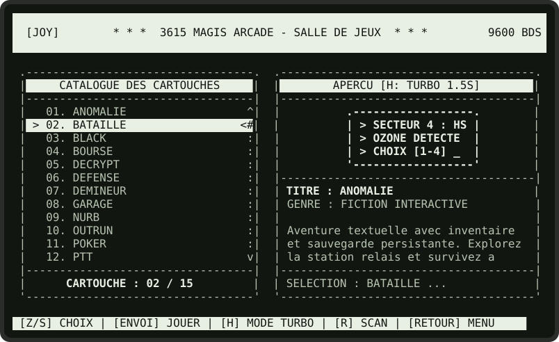<br><sub><b>Fig. 3.2</b> — Le lanceur de jeux. La fiche de droite attend que le curseur s'arrête pour se mettre à jour.</sub></p>

**Les métadonnées.** Le lanceur lit les 15 premières lignes de chaque fichier et y cherche des balises en commentaire :

```lua
-- @GENRE: GESTION / SPECULATION
-- @DESC: Achetez et revendez des composants rares entre 6 villes en 30 jours.
-- @ART1:   .------------.
-- @ART2:   |  MON LOGO  |
-- @ART3:   |   ASCII    |
-- @ART4:   |   5 LIGNES |
-- @ART5:   '------------'
```

| Balise | Rôle |
| :----- | :--- |
| `@GENRE` ou `@TYPE` | Catégorie affichée dans la fiche. Elle choisit aussi le **logo automatique**. |
| `@DESC` | Description, coupée en 3 lignes de 36 caractères. |
| `@ART1` à `@ART5` | Logo personnalisé (les 5 lignes sont obligatoires, sinon le logo automatique est utilisé). |

Le lanceur calcule aussi la **taille** du fichier et son **nombre de lignes**. Sans balise `@GENRE`, il choisit un logo d'après le nom du fichier.

**Le logo automatique.** Le genre (et le nom du fichier) est comparé à une liste de mots-clés : `CASINO` ou `POKER` donnent des cartes à jouer, `BOURSE` un graphique boursier, `RPG` un donjon, `TABLEUR` une grille, `TRAIN` une locomotive, `CARBURANT` une pompe, `SANTE` un cœur, `METEO` des nuages, etc.

**Le mode turbo `[H]`.** Redessiner la fiche de droite coûte plusieurs centaines d'octets, soit près d'une demi-seconde à 9600 bauds. En mode turbo (actif par défaut), faire défiler la liste ne déplace que le curseur, et la fiche n'est redessinée qu'**1,5 seconde après le dernier mouvement**. En mode direct, elle suit chaque mouvement.

<p align="center">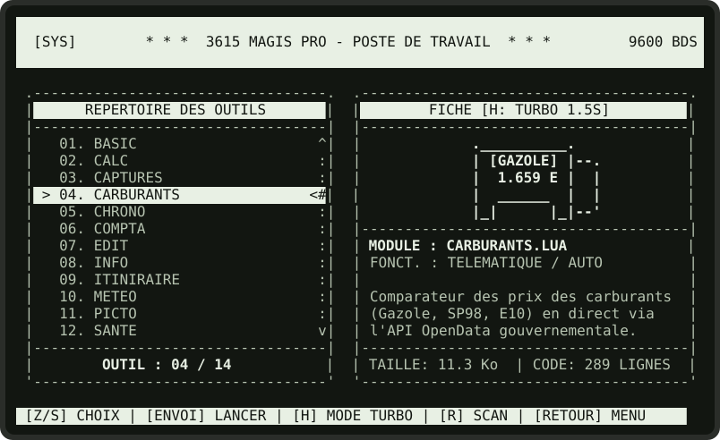<br><sub><b>Fig. 3.3</b> — Le lanceur d'outils, même mécanique sur le dossier <code>utils/</code>.</sub></p>

| Touche | Fonction |
| :----- | :------- |
| `Z` / `S` ou flèches | Choisir une cartouche (barre de défilement à droite de la liste). |
| `[ENVOI]` | Lancer. Au retour du programme, le lanceur se redessine. |
| `H` | Basculer mode turbo / mode direct. |
| `R` | Rescanner le dossier (après y avoir copié un nouveau fichier). |
| `[RETOUR]` | Revenir au portail. |

### 3.5 La mise à jour (`updater.lua`)

Le système se met à jour depuis son dépôt Git. Le programme est lancé automatiquement au démarrage à froid si le réseau répond, ou à la demande depuis le portail.

```text
  Sauvegarde : utils/prog_basic/ -> /home/minitel/minitel_gc_backup/
                 |
                 v
  git status --porcelain : y a-t-il des modifications locales ?
        |                      |
       NON                    OUI  ->  ecran "CONFLIT LOCAL"
        |                      |
        |   [1] FORCER : git reset --hard + git clean -fd (local ecrase)
        |   [2] SAUVEGARDER ET ENVOYER : git add, commit, push
        |   [3] RENOMMER : chaque fichier modifie devient nom_local.ext
        |   [4] ANNULER : retour au portail sans rien toucher
        v                      |
  git pull  <------------------+
        |
        v
  Retour au portail (la session se relance)
```

> **Important.** Avant toute opération, vos programmes BASIC sont copiés dans `/home/minitel/minitel_gc_backup/utils/prog_basic_backup/`. Les fichiers listés dans `.gitignore` (comme le dossier `utils/sante/`) ne sont jamais envoyés ni effacés par la mise à jour.

### 3.6 Les fichiers de réglages et de données

| Fichier ou dossier | Créé par | Contenu |
| :----------------- | :------- | :------ |
| `/tmp/minitel_warmboot` | Portail | Témoin de démarrage à chaud (effacé à l'extinction). |
| `jeux/minitel_*.cfg` | Les jeux | Réglages (difficulté, mise de départ, son…). |
| `utils/pictochat.cfg` | PICTO, BATAILLE, QUIZZ | Ligne 1 : adresse du serveur. Ligne 2 : pseudo. |
| `utils/prog_basic/*.bas` | MICRO-BASIC | Programmes BASIC, en texte brut. |
| `utils/music/*.MOD` | PROTRACKER | Morceaux (tables Lua). |
| `utils/sante/` | 3615 SANTE | Export Apple Health et cache. **Données personnelles, ignorées par Git.** |
| `screenshots/screen_*.txt` | `Ctrl`+`P` | Captures d'écran en texte 80 × 24. |
| `/tmp/minitel_pwm_*.pid` | MICRO-BASIC | Processus des signaux PWM logiciels en cours. |

### 3.7 L'impression d'écran

Depuis **n'importe quel programme**, la touche **Impression** du Minitel (ou `F12`, ou `Ctrl`+`P` au clavier) déclenche une capture d'écran. C'est possible parce que `minitel.lua` tient à jour une **copie en mémoire de l'écran** (§ 4.3).

1. Le contenu de l'écran est enregistré dans `screenshots/screen_AAAAMMJJ_HHMMSS.txt`.
2. Le fichier est **envoyé sur un service de partage de texte public** (`dpaste.com`, ou `paste.rs` en secours), et l'adresse obtenue s'affiche dans une fenêtre.
3. À la fermeture de la fenêtre, l'écran d'origine est restauré à l'identique à partir de la copie en mémoire.

> **Confidentialité.** Le lien de partage est public. N'imprimez pas un écran qui contient des informations personnelles (par exemple les données de 3615 SANTE). Hors ligne, la capture reste seulement en local.

Les captures se consultent avec **3615 CAPTURES** (§ 5.5).

### 3.8 Les services réseau

**Le serveur 3615 PICTO.** `server.py` est un petit serveur HTTP écrit en Python, sans aucune dépendance. Il héberge quatre salons de discussion (A, B, C, D), compte les connectés et sert aussi un client web. La messagerie **3615 PICTO**, la **BATAILLE NAVALE** en ligne et le **QUIZZ** multijoueur s'en servent.

| Point d'accès | Méthode | Rôle |
| :------------ | :------ | :--- |
| `/` | GET | Client web (navigateur). |
| `/api/poll?room=A&since=N` | GET | Nouveaux messages d'un salon depuis le message `N`. |
| `/api/send` | GET ou POST | Envoi d'un message. |

Le fichier `docker-compose.yml` déploie ce serveur (port **8085**) ainsi qu'une **passerelle Discord** (`discord_bridge.py`) qui relie le salon D à un salon Discord (jeton à fournir dans la variable `DISCORD_TOKEN`).

```bash
docker compose up -d
```

**Les services Internet utilisés.**

| Programme | Service interrogé |
| :-------- | :---------------- |
| 3615 CARBURANT | Prix des carburants, `data.economie.gouv.fr` (données publiques) |
| 3615 TRAIN | Tableau des départs, `transport.opendata.ch` |
| 3615 ITINÉRAIRE | Géocodage `api-adresse.data.gouv.fr` et calcul d'itinéraire OSRM |
| 3615 MÉTÉO | `wttr.in` |
| 3615 MAGIS INFOS | Flux RSS d'un site d'actualité technologique |
| 3615 QUIZZ (solo) | Questions générées par `quizzapi.jomoreschi.fr` |
| 3615 DÉCRYPTAGE | Liste de mots français (téléchargée une fois, puis conservée) |
| Impression d'écran | `dpaste.com` / `paste.rs` |

<div style="page-break-after: always;"></div>

## CHAPITRE 4 : LE MOTEUR GRAPHIQUE ET LE SDK (`minitel.lua`)

### 4.1 Le budget de bande passante

Tout programme pour Minitel doit respecter une arithmétique simple :

```text
   9600 bauds  /  10 bits par caractere  =  960 caracteres par seconde

   Ecran complet : 80 x 24 = 1 920 caracteres
                 + sequences de positionnement et d'attributs
                 = 2 000 a 2 500 octets  =  2 a 2,5 SECONDES
```

Redessiner tout l'écran à chaque touche frappée donnerait un système d'une lenteur insupportable : on verrait l'image se construire ligne par ligne. Pour paraître instantané, un programme doit envoyer **moins de 100 octets** en réponse à une touche (environ 0,1 seconde).

### 4.2 Le principe du delta-drawing

La technique employée dans tout le système s'appelle ici le **delta-drawing** (« dessin différentiel ») :

1. **Le squelette, une seule fois.** À l'ouverture d'un écran, on dessine tout ce qui ne bougera plus : bandeaux, cadres, libellés, barre de touches. C'est le seul moment où l'on paie le prix d'un écran complet.
2. **Les changements, rien de plus.** Ensuite, on ne réécrit **que les zones qui changent**, en positionnant directement le curseur avec `ESC[ligne;colonneH`.

Exemple : déplacer la sélection d'une ligne vers le bas dans une liste.

```text
  Sans delta-drawing : redessiner la liste entiere   ~ 2 000 octets (2 s)

  Avec delta-drawing :
     ESC[9;3H   "   02. 3615 OUTILS   "            <- ancienne ligne, normale
     ESC[10;3H  ESC[7m " > 03. MAGIS EDIT < " ESC[0m  <- nouvelle, inversee
                                                    ~    80 octets (0,08 s)
```

Les programmes les plus élaborés poussent l'idée plus loin. **3615 WOLF-3D** calcule son image 3D dans un tampon et ne transmet que les caractères qui diffèrent de l'image précédente (*double tampon différentiel*). **3615 SANTE** garde en mémoire le contenu de chaque zone et n'envoie une valeur que si elle a changé.

### 4.3 Le framebuffer virtuel

Au chargement, `minitel.lua` remplace discrètement la fonction d'écriture standard `io.write`. Chaque octet envoyé au Minitel passe par un petit **interpréteur VT100** qui tient à jour une copie de l'écran en mémoire : un tableau de 24 lignes de 80 caractères, avec la position du curseur.

* Les programmes n'ont rien à faire de particulier : ils écrivent comme d'habitude.
* `minitel.get_screen_text()` renvoie à tout moment le contenu exact de l'écran, en texte.
* C'est ce mécanisme qui permet l'**impression d'écran** (§ 3.7) et la **restauration** de l'écran après la fenêtre d'impression.

### 4.4 Référence des fonctions du SDK

Tout programme commence par :

```lua
local minitel = require("minitel")
minitel.init()
```

et se termine par `minitel.cleanup()`.

#### Système et matériel

| Fonction | Description |
| :------- | :---------- |
| `minitel.init()` | Configure la liaison (`raw`, `-echo`, lecture non bloquante) et masque le curseur. |
| `minitel.cleanup()` | Remet les marges de défilement à zéro, réaffiche le curseur, efface l'écran, rétablit le terminal (`stty sane`). |
| `minitel.sleep(secondes)` | Pause (par la commande `sleep` du système, avec repli sur une attente active). Les boucles principales utilisent typiquement `minitel.sleep(0.01)` à `0.05`. |
| `minitel.play_sound(effet)` | Joue un effet en tâche de fond : `"hit"`, `"win"`, `"pickup"`, `"lose"`, `"damage"` (§ 2.5). |
| `minitel.get_key()` | Lit le clavier **sans attendre**. Renvoie un nom de touche (§ 2.3), un caractère, ou `nil` si rien n'a été frappé. |
| `minitel.get_screen_text()` | Contenu de l'écran (24 lignes de texte séparées par des retours à la ligne). |
| `minitel.print_screen_to_pastebin()` | Déclenche l'impression d'écran (normalement appelée par `get_key()` lui-même). |

#### Mise en forme du texte

| Fonction | Description |
| :------- | :---------- |
| `minitel.pad(texte, n)` | Tronque ou complète par des espaces pour obtenir **exactement** `n` caractères. Indispensable pour effacer proprement l'ancienne valeur d'un champ. |
| `minitel.center(texte, n)` | Centre le texte dans une largeur de `n` caractères. |
| `minitel.clean_accents(texte)` | Remplace les lettres accentuées par leurs équivalents sans accent (`é` → `E`, `ç` → `C`, `œ` → `OE`). |
| `minitel.wrap(texte, largeur, lignes_max)` | Découpe un paragraphe mot à mot. Renvoie un tableau de lignes déjà complétées à `largeur` ; avec `lignes_max`, le tableau a toujours exactement ce nombre de lignes. |

#### Composants d'interface

| Fonction | Description |
| :------- | :---------- |
| `minitel.draw_window(x, y, l, h, titre)` | Cadre en `+`, `-` et `|` de `l` × `h` caractères en `(x, y)`, intérieur effacé, titre centré en vidéo inverse dans le bord supérieur. |
| `minitel.progress_bar(x, y, l, valeur, max, pct)` | Jauge `[████......]` en vidéo inverse ; avec `pct = true`, ajoute le pourcentage. |
| `minitel.msg_box(titre, message, son)` | Fenêtre d'information modale ; attend `[ENVOI]`, `[RETOUR]` ou Espace. |
| `minitel.confirm_box(titre, question)` | Fenêtre OUI / NON. Flèches ou `Q`/`D` pour choisir, `O` / `N` en raccourci. Renvoie `true` ou `false`. |
| `minitel.input_box(titre, invite, défaut, longueur_max)` | Saisie d'une ligne de texte (44 caractères au plus) avec `[CORRECTION]` et `[ANNULATION]` (tout effacer). Renvoie le texte, ou `nil` si `[RETOUR]`. |
| `minitel.file_browser(mode, dossier)` | Explorateur de fichiers, `mode` = `"OPEN"` ou `"SAVE"`. Navigation dans les sous-dossiers ; en mode `"SAVE"`, un champ permet de taper le nom. Renvoie le chemin complet ou `nil`. |

Ces composants ont une **position fixe** (centrés sur l'écran), ce qui donne à tous les programmes un aspect uniforme. Ils ne restaurent pas ce qu'ils recouvrent : après leur fermeture, le programme doit redessiner son écran.

<table>
<tr>
<td align="center">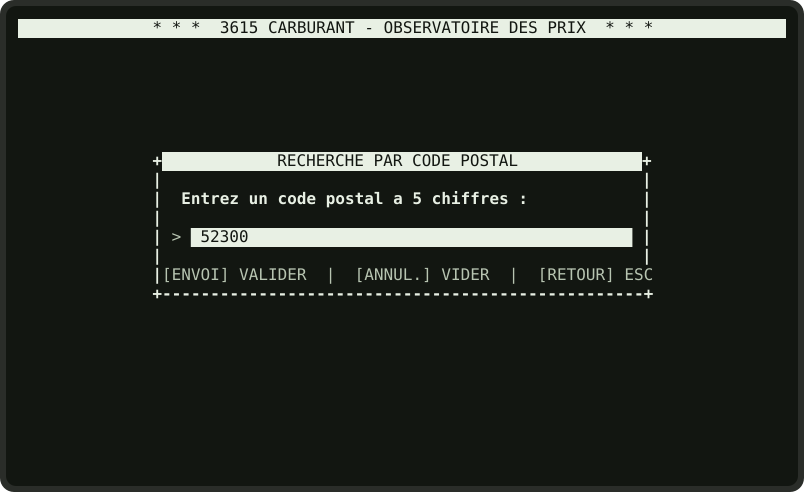<br><sub><b>Fig. 4.1</b> — <code>input_box</code></sub></td>
<td align="center">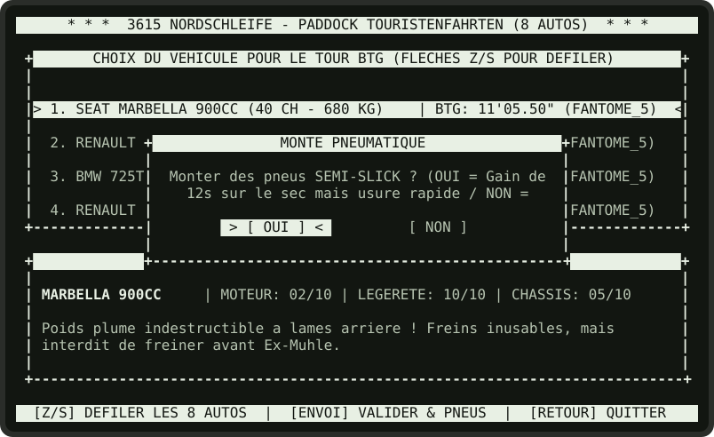<br><sub><b>Fig. 4.2</b> — <code>confirm_box</code> par-dessus un écran</sub></td>
</tr>
<tr>
<td align="center" colspan="2">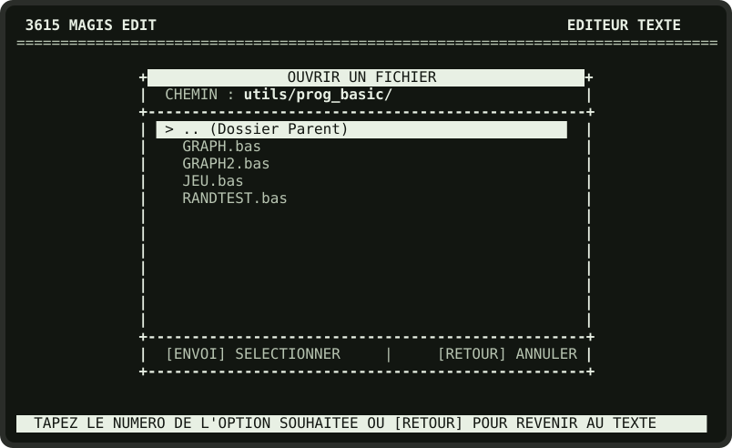<br><sub><b>Fig. 4.3</b> — <code>file_browser("OPEN", "utils/prog_basic/")</code></sub></td>
</tr>
</table>

<div style="page-break-after: always;"></div>

## CHAPITRE 5 : LES LOGICIELS DU POSTE DE TRAVAIL (`/utils`)

Tous ces logiciels se lancent depuis **3615 OUTILS**. Leurs touches sont rappelées en permanence sur la ligne 24.

### 5.1 MAGIS EDIT — traitement de texte plein écran (`edit.lua`)

Éditeur de texte et de code source en 80 colonnes. La zone de texte est une **zone de défilement matérielle** (`ESC[3;24r`) : quand le texte défile, c'est le Minitel lui-même qui fait glisser les lignes, sans qu'il faille les retransmettre.

<p align="center">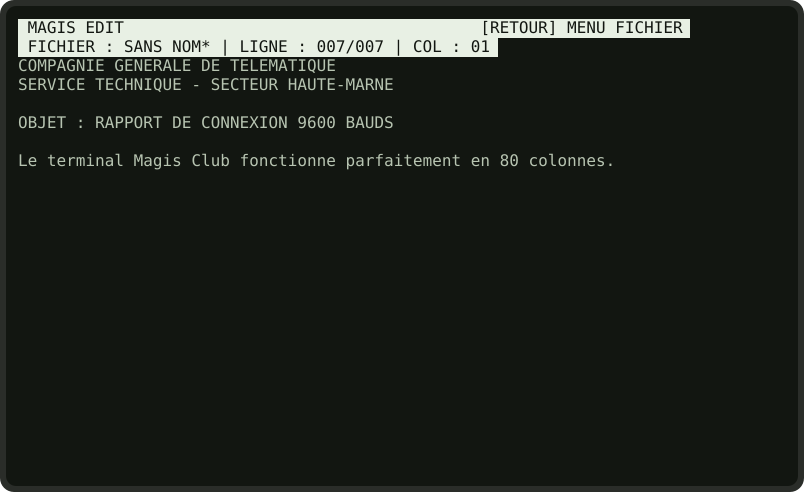<br><sub><b>Fig. 5.1</b> — MAGIS EDIT. L'astérisque après le nom signale un texte non sauvegardé.</sub></p>

| Touche | Fonction |
| :----- | :------- |
| Flèches, Début, Fin | Déplacer le curseur. |
| `[ENVOI]` | Couper la ligne au curseur (nouvelle ligne). |
| `[CORRECTION]` | Effacer le caractère à gauche ; en colonne 1, fusionner avec la ligne précédente. |
| `[ANNULATION]` | Vider la ligne courante. |
| `[RETOUR]` | Menu fichier. |

<p align="center">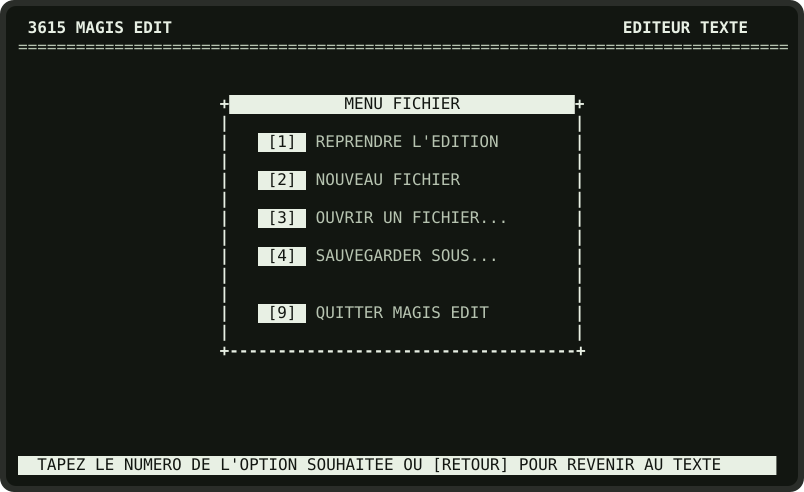<br><sub><b>Fig. 5.2</b> — Le menu fichier : nouveau, ouvrir et sauvegarder passent par l'explorateur du SDK.</sub></p>

> **Astuce.** MAGIS EDIT est l'outil idéal pour taper un long programme BASIC : enregistrez-le dans `utils/prog_basic/` avec l'extension `.bas`, puis chargez-le dans le BASIC avec `LOAD`.

### 5.2 MAGIS CALC — tableur multi-feuilles (`calc.lua`)

Un tableur complet : plusieurs feuilles par classeur, formules recalculées, références entre feuilles. Sa particularité : toutes les formules peuvent s'écrire **en toutes lettres**, sans les symboles difficiles d'accès sur le clavier du Minitel.

<p align="center">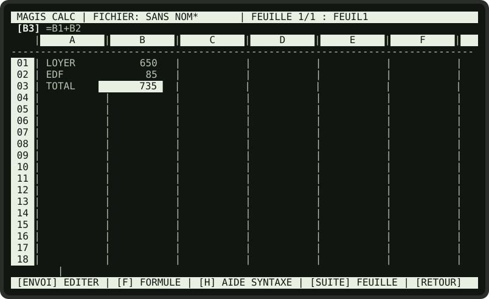<br><sub><b>Fig. 5.3</b> — Une feuille simple. La cellule active B3 contient la formule <code>=B1+B2</code>.</sub></p>

**Écrire une formule.** Commencez la saisie par `=`, par `CALC ` ou par `EQ ` (ou appuyez sur `[F]` sur la cellule).

| Écriture avec symboles | Écriture en toutes lettres | Résultat |
| :--------------------- | :------------------------- | :------- |
| `=A1+B1` | `CALC A1 PLUS B1` | Addition (`MOINS` pour soustraire) |
| `=A1*1.2` | `CALC A1 FOIS 1.2` | Multiplication (`DIV` pour diviser, `MOD`, `POW`) |
| `=SOMME(A1:A10)` | `CALC SOMME A1 A A10` | Somme d'une plage (aussi `MOYENNE`, `MIN`, `MAX`) |
| `=FEUIL1!B4*1.2` | `CALC FEUIL1 DE B4 FOIS 1.20` | Référence à une autre feuille |
| — | `CALC SI A1 GT 100 ALORS 50 SINON 0` | Condition (`EQ` `NEQ` `LT` `GT` `LE` `GE`, `ET`, `AND`) |

<p align="center">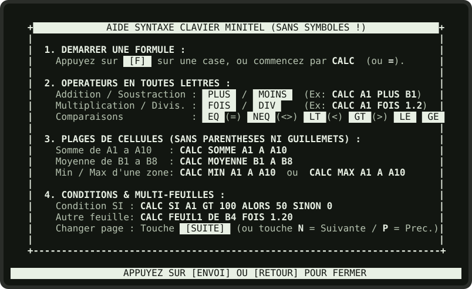<br><sub><b>Fig. 5.4</b> — L'aide intégrée, touche <code>[H]</code>.</sub></p>

| Touche | Fonction |
| :----- | :------- |
| Flèches | Se déplacer de cellule en cellule. |
| `[ENVOI]` | Éditer la cellule. |
| `F` | Saisir une formule. |
| `H` | Aide syntaxe. |
| `[SUITE]` (ou `N` / `P`) | Feuille suivante / précédente. |
| `[RETOUR]` | Menu : nouveau classeur, ajouter une feuille, ouvrir, sauvegarder sous, quitter. |

### 5.3 Les services télématiques en direct

Ces programmes interrogent Internet au moment où vous les consultez. Ils commencent tous par une boîte de saisie (code postal, gare, ville) qui propose une valeur par défaut.

<p align="center">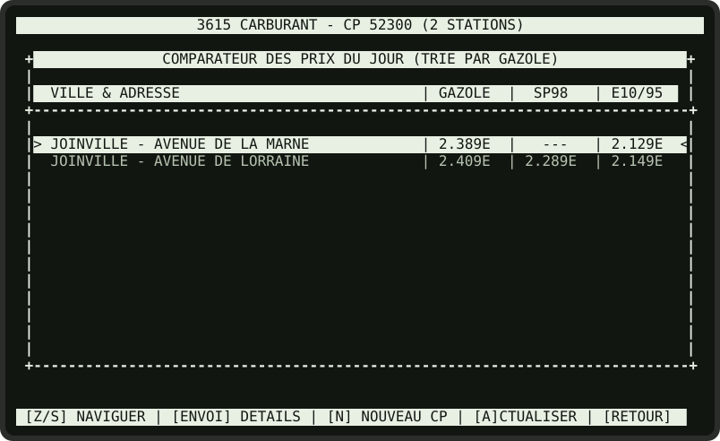<br><sub><b>Fig. 5.5</b> — 3615 CARBURANT : les stations d'un code postal, triées par prix du gazole.</sub></p>

* **3615 CARBURANT** (`carburants.lua`). Prix instantanés du gazole, du SP98 et de l'E10 d'après les données publiques du ministère de l'Économie. Si aucune station n'existe pour le code postal saisi, la recherche s'élargit au département. `[ENVOI]` affiche la fiche détaillée d'une station, `[N]` change de code postal, `[A]` actualise.

<p align="center">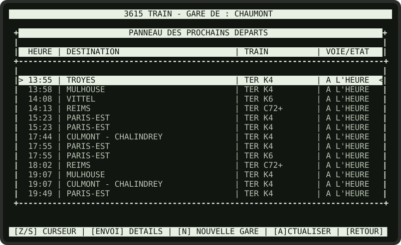<br><sub><b>Fig. 5.6</b> — 3615 TRAIN : le tableau des départs d'une gare.</sub></p>

* **3615 TRAIN** (`train.lua`). Tableau des prochains départs d'une gare : heure, destination, numéro du train, voie et retard éventuel.

<p align="center">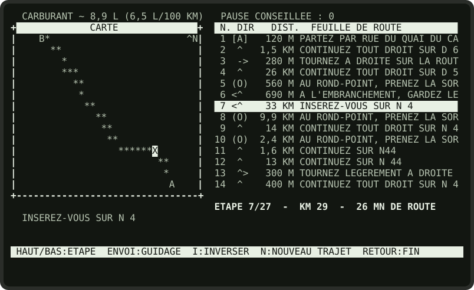<br><sub><b>Fig. 5.7</b> — 3615 ITINÉRAIRE : distance, durée et feuille de route détaillée.</sub></p>

* **3615 ITINÉRAIRE** (`itiniraire.lua`). Calcul d'un trajet routier entre deux communes : distance, durée, puis la feuille de route étape par étape, à faire défiler.
* **3615 MÉTÉO** (`meteo.lua`). Prévisions pour une ville (ou détection automatique si on laisse le champ vide).
* **3615 MAGIS INFOS** (`info.lua`). Les titres d'un journal d'actualité technologique ; `[ENVOI]` ouvre l'article, débarrassé de sa mise en forme HTML et reformaté en 80 colonnes.

<p align="center">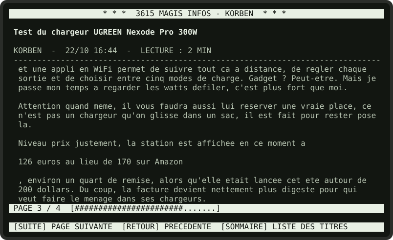<br><sub><b>Fig. 5.8</b> — 3615 MAGIS INFOS : la liste des articles.</sub></p>

* **3615 PICTO** (`picto.lua`). Messagerie instantanée à quatre salons (A à D), dans l'esprit du PictoChat de la Nintendo DS : pseudos, compteur de connectés, petits dessins ASCII. Nécessite le serveur décrit au § 3.8. À chaque lancement, l'adresse du serveur et le pseudo sont proposés pour confirmation, pré-remplis avec les valeurs mémorisées dans `utils/pictochat.cfg`.

### 5.4 3615 COMPTABILITÉ (`compta.lua`)

Calculatrice libre (tapez une expression comme `2.5 * 10`) et convertisseurs francs ↔ euros, avec l'historique des opérations à l'écran.

<p align="center">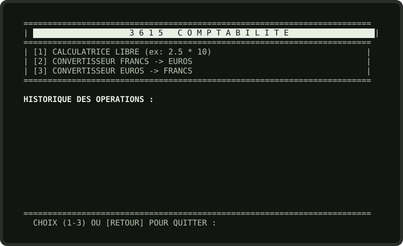<br><sub><b>Fig. 5.9</b> — 3615 COMPTABILITÉ.</sub></p>

### 5.5 3615 CAPTURES — le spouleur d'impression (`captures.lua`)

Galerie des captures d'écran prises avec `Ctrl`+`P` (§ 3.7) : liste à gauche, aperçu à droite. `[ENVOI]` affiche une capture en plein écran, `[P]` l'envoie sur un service de partage public, `[ANNULATION]` la supprime.

<p align="center">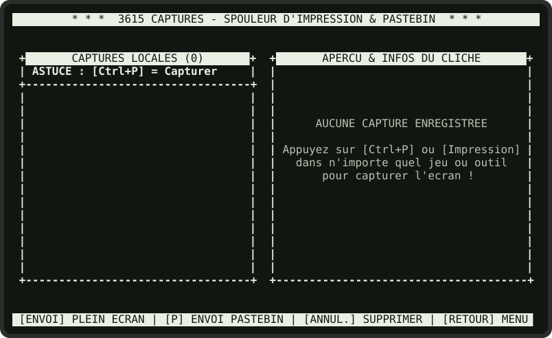<br><sub><b>Fig. 5.10</b> — 3615 CAPTURES, ici sans aucune capture enregistrée.</sub></p>

### 5.6 3615 PROTRACKER — séquenceur musical (`tracker.lua`)

Un séquenceur dans la tradition des *trackers* de l'Amiga : 16 pas, 4 pistes. Les pistes 1 à 3 sont des synthétiseurs (onde carrée, dent de scie, triangle) ; la piste 4 est une boîte à rythmes. Le son est synthétisé en temps réel par SoX, qui **mixe toutes les voix d'un pas dans un seul processus** pour rester synchrone.

<p align="center">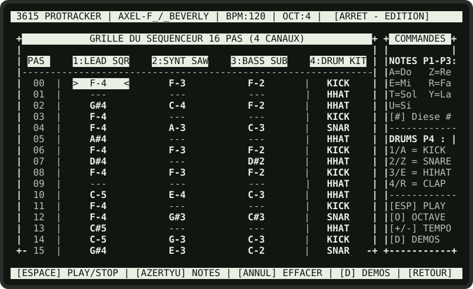<br><sub><b>Fig. 5.11</b> — La grille de 16 pas, chargée avec la première démo.</sub></p>

| Touche | Fonction |
| :----- | :------- |
| Flèches | Se déplacer dans la grille. |
| `A` `Z` `E` `R` `T` `Y` `U` | Notes do, ré, mi, fa, sol, la, si (pistes 1 à 3). Le curseur descend d'un pas après chaque note. |
| `#` | Transformer la note en dièse (ou revenir en naturel). |
| `1` `2` `3` `4` (ou `A` `Z` `E` `R`) | Grosse caisse, caisse claire, charleston, clap (piste 4). |
| `O` | Octave suivante (2 à 5). |
| `+` / `-` | Tempo (60 à 200 BPM). |
| `M` | Couper / rétablir la piste courante. |
| Espace | Lecture / arrêt. |
| `[ANNULATION]` | Effacer la case. |
| `D` ou `[RETOUR]` | Menu : trois démos (*Axel F*, *Techno 1992*, *Outrun*), nouveau, ouvrir, sauvegarder (`utils/music/`), quitter. |

### 5.7 3615 SANTE — carnet Apple Health (`sante.lua`)

Apple Santé ne propose aucune interface réseau : le carnet lit l'**export officiel de l'iPhone**.

1. Sur l'iPhone : app **Santé** > photo de profil > **Exporter toutes les données de santé**.
2. Copiez le fichier `exportation.zip` (ou `export.zip`) dans `utils/sante/` sur le Raspberry Pi.
3. Onglet **[4] IMPORT**, touche `[ENVOI]`. Le ZIP est lu directement (commande `unzip -p`, paquet `unzip` requis), sans être décompressé sur la carte SD.

L'import agrège les mesures jour par jour dans `utils/sante/cache_sante.lua`, si bien que les ouvertures suivantes sont instantanées. Les pas, distances et calories sont totalisés **par appareil**, et seul l'appareil au plus gros total est retenu : un pas compté à la fois par l'iPhone et par l'Apple Watch n'est donc pas compté deux fois.

<p align="center">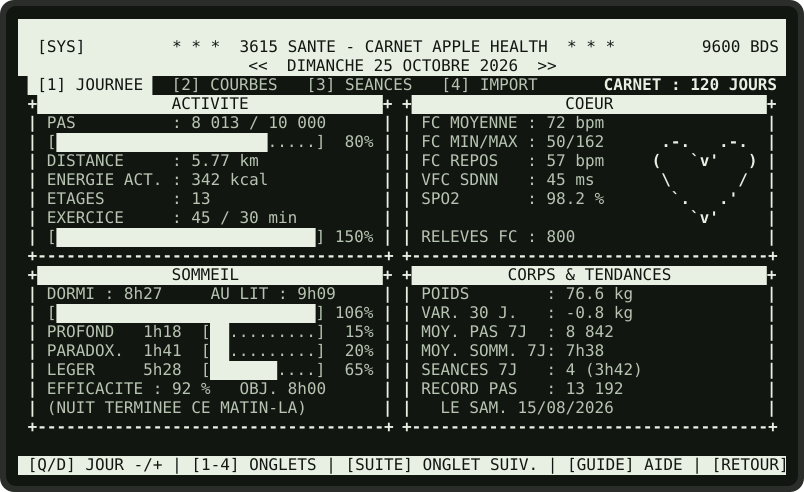<br><sub><b>Fig. 5.12</b> — L'onglet JOURNÉE (données de démonstration).</sub></p>

<p align="center">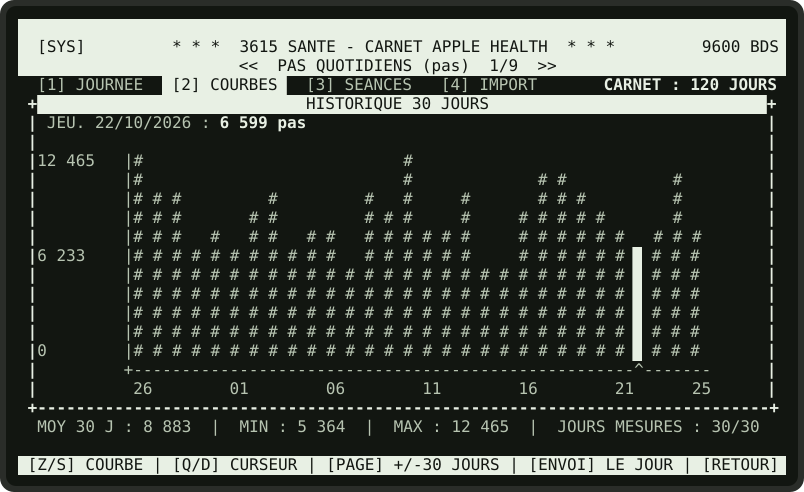<br><sub><b>Fig. 5.13</b> — L'onglet COURBES : 30 jours d'un indicateur, avec un curseur jour par jour (colonne en vidéo inverse).</sub></p>

| Onglet | Contenu | Touches |
| :----- | :------ | :------ |
| **[1] JOURNÉE** | Activité, cœur, sommeil par phases, poids, tendances sur 7 et 30 jours | `Q`/`D` ou flèches : jour précédent / suivant (seulement les jours avec des mesures) |
| **[2] COURBES** | Histogramme de 30 jours, 9 indicateurs | `Z`/`S` : indicateur. `Q`/`D` : curseur. `[PAGE]` : ±30 jours. `[ENVOI]` : ouvrir le jour pointé |
| **[3] SÉANCES** | Journal des entraînements de l'Apple Watch | `Z`/`S` : choisir. `[ENVOI]` : ouvrir le jour de la séance |
| **[4] IMPORT** | Mode d'emploi, état du carnet, import | `[ENVOI]` : importer. `F` : choisir le fichier. `D` : 120 jours de données fictives. `X` : effacer le carnet |

`[SUITE]` passe à l'onglet suivant, `[GUIDE]` affiche une aide.

<div style="page-break-after: always;"></div>

## CHAPITRE 6 : LA SALLE D'ARCADE (`/jeux`)

Quinze cartouches, accessibles depuis **3615 JEUX**. La plupart ouvrent sur un écran-titre ou un briefing ; les touches sont toujours rappelées en bas de l'écran.

### 6.1 Action et course

<p align="center">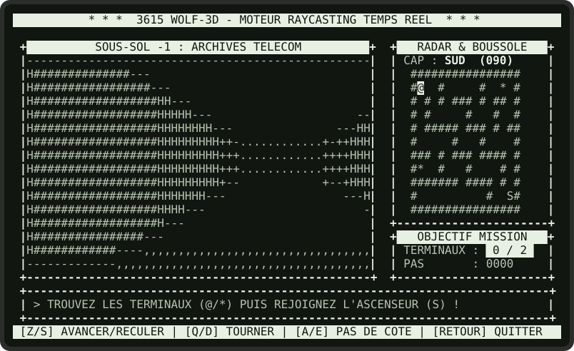<br><sub><b>Fig. 6.1</b> — 3615 WOLF-3D : vue subjective calculée par lancer de rayons, et radar du niveau.</sub></p>

**3615 WOLF-3D** (`wolf.lua`) — *Action / 3D par lancer de rayons.* Un vrai moteur 3D en mode texte. Pour chaque colonne de l'écran, un rayon est lancé dans le plan du labyrinthe (algorithme DDA) ; la distance du mur rencontré donne la hauteur de la colonne, et le caractère employé (`H`, `+`, `-`…) suggère l'éloignement. Seuls les caractères qui ont changé depuis l'image précédente sont transmis. Piratez les terminaux (`*`) de chaque sous-sol pour débloquer l'ascenseur (`S`). `Z`/`S` avancer et reculer, `Q`/`D` tourner, `A`/`E` pas de côté.

<p align="center">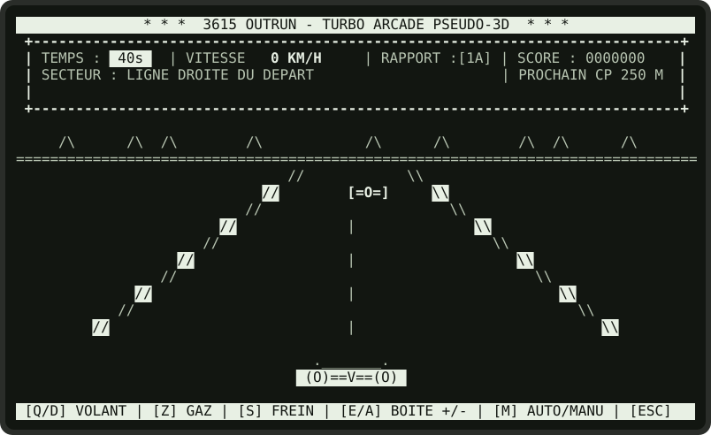<br><sub><b>Fig. 6.2</b> — 3615 OUTRUN : route en pseudo-3D, compteur, rapport engagé et checkpoint.</sub></p>

**3615 OUTRUN** (`outrun.lua`) — *Course d'arcade en pseudo-3D.* Une impulsion sur `Z` lance le moteur et l'accélérateur reste maintenu. Compensez la force centrifuge avec `Q` et `D`, évitez le trafic et passez les checkpoints avant la fin du chrono. `S` freine, `E`/`A` changent de rapport, `M` bascule boîte automatique / manuelle.

**3615 NORDSCHLEIFE** (`nurb.lua`) — *Simulation automobile.* Les 20,8 km du circuit du Nürburgring en *Touristenfahrten*, au volant de huit voitures (Seat Marbella, Renault Twingo, BMW 725tds, Renault 25 V6 Turbo, V8 américaine…). Gérez freins et pneus (semi-slicks ou non), et battez les temps des fantômes.

<p align="center">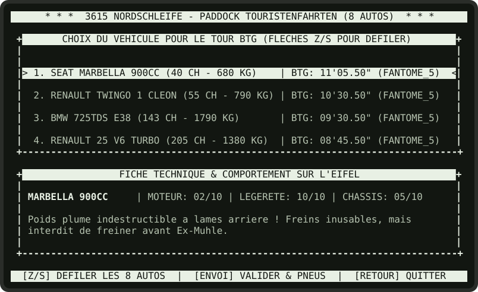<br><sub><b>Fig. 6.3</b> — Le paddock : choix de la voiture et fiche technique.</sub></p>

### 6.2 Jeu de rôle et aventure

<p align="center">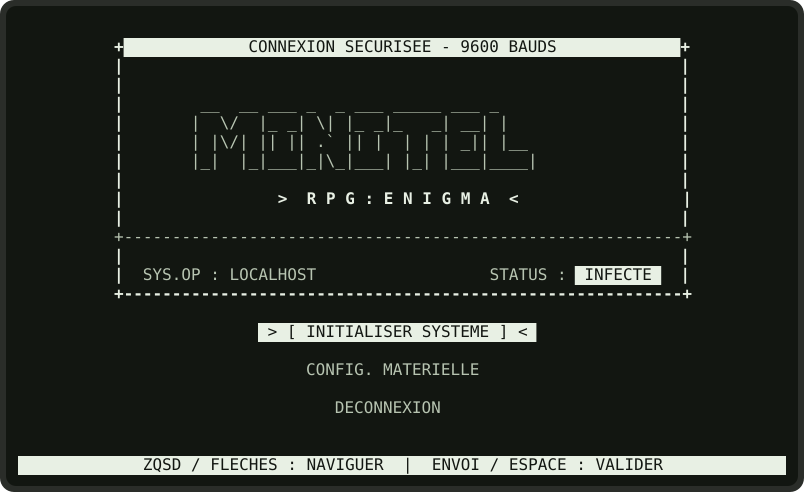<br><sub><b>Fig. 6.4</b> — L'écran-titre de RPG : ENIGMA.</sub></p>

**RPG : ENIGMA** (`rpg.lua`) — *Rogue-like cybernétique.*
* **L'histoire.** En composant `3615 ENIGMA`, vous avez forcé un verrou cryptographique oublié du réseau Transpac. Votre conscience est aspirée dans un serveur infecté, sous la forme du processus **ROOT** (`@`).
* **La carte.** `@` vous, `#` paroi mémoire, `+` patch de soin, `*` cycle processeur (bonus d'*overclocking* permanent), `>` passerelle vers le nœud inférieur.
* **Le combat.** Six familles de programmes malveillants, du *Worm* au *Noyau Fantôme*, et quatre contre-mesures : **INJECTION** (précise), **OVERLOAD** (risquée mais dévastatrice), **PATCHER** (soin) et **ABORT** (fuite).

**3615 ANOMALIE** (`anomalie.lua`) — *Fiction interactive.* Une aventure textuelle dans la station relais du Secteur 4 : choix numérotés, intégrité physique, inventaire (un `BADGE` ou une `CLEF_CRYPTO` ouvrent des chemins sans combat). La touche `S` sauvegarde la partie à tout moment ; on la recharge depuis le menu d'accueil.

<p align="center">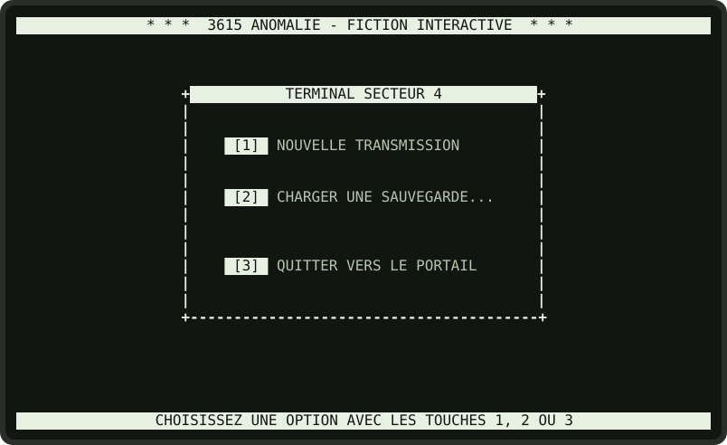<br><sub><b>Fig. 6.5</b> — Le terminal du Secteur 4.</sub></p>

### 6.3 Gestion et simulation

<p align="center">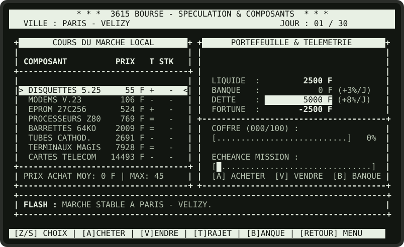<br><sub><b>Fig. 6.6</b> — 3615 BOURSE : cours du marché local et portefeuille.</sub></p>

**3615 BOURSE** (`bourse.lua`) — *Gestion et spéculation.* Courtier sur le marché gris des composants électroniques à la fin des années 1980, vous avez **30 jours** pour rembourser une dette de **5 000 F** (8 % d'intérêts par jour !) en achetant et revendant entre six villes. Guettez les pénuries (`!`, prix multipliés) et les déstockages (`v`, prix divisés). Le jeu suit votre prix d'achat moyen pour calculer la marge avant chaque vente. `A` acheter, `V` vendre, `T` voyager, `B` banque.

**3615 GARAGE** (`garage.lua`) — *Simulation de garage, 1993.* Diagnostiquez la panne d'une voiture de client avec la valise XR25, le banc Souriau et l'inspection mécanique, puis choisissez la bonne réparation : une erreur coûte cher. Ou préparez des moteurs en gravant des EPROM 27C256 sur le banc à rouleaux.

<p align="center">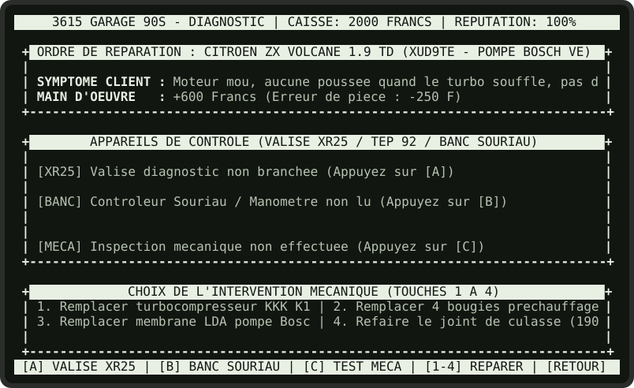<br><sub><b>Fig. 6.7</b> — Un ordre de réparation : à vous de trouver la panne.</sub></p>

**3615 CENTRAL PTT** (`ptt.lua`) — *Simulation télécom, 1994.* Ingénieur de nuit au centre de commutation : surveillez la charge de l'autocommutateur Alcatel E10B, du PABX, du frontal Vidéotex et du nœud Transpac. Au-delà de 92 % de charge, les abonnés ont la tonalité d'occupation. `D` délester le trafic, `P` réarmer une carte en alarme, `B` faisceau hertzien de secours.

<p align="center">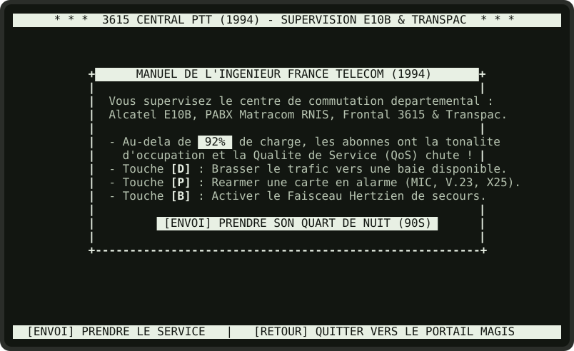<br><sub><b>Fig. 6.8</b> — Le manuel de l'ingénieur, avant la prise de service.</sub></p>

### 6.4 Casino et cartes

<p align="center">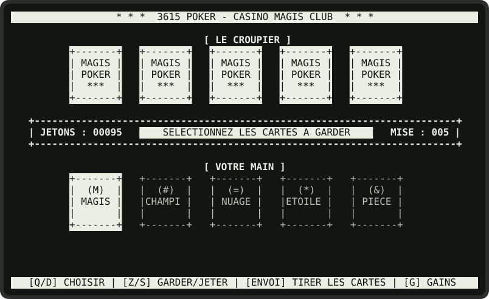<br><sub><b>Fig. 6.9</b> — 3615 POKER : choisissez les cartes à garder.</sub></p>

**3615 POKER** (`poker.lua`) — Poker fermé à 5 cartes contre le croupier, avec un jeu de symboles télématiques. Flèches pour miser, `M` pour une mise libre, `G` pour la table des gains (carré ×8, cinq identiques ×16).

**3615 BLACKJACK** (`black.lua`) — Le Blackjack classique. Mise de départ, mise minimale et nombre de jeux sont réglables dans `jeux/minitel_blackjack.cfg`.

### 6.5 Réflexion

**MINITEL SWEEPER** (`demineur.lua`) — Le démineur. Trois niveaux de difficulté, son activable. `[ENVOI]` creuser, `F` poser un drapeau.

**3615 DÉCRYPTAGE** (`decrypt.lua`) — Le jeu de lettres façon *Motus*, déguisé en piratage de serveur : trouvez le mot secret en six essais. Le dictionnaire est téléchargé une fois sur Internet, avec une liste de secours hors ligne.

**3615 DÉFENSE** (`defense.lua`) — *Tower defense* au tour par tour : bâtissez des tourelles le long du chemin pour protéger votre base. Trois niveaux de difficulté.

<table>
<tr>
<td align="center">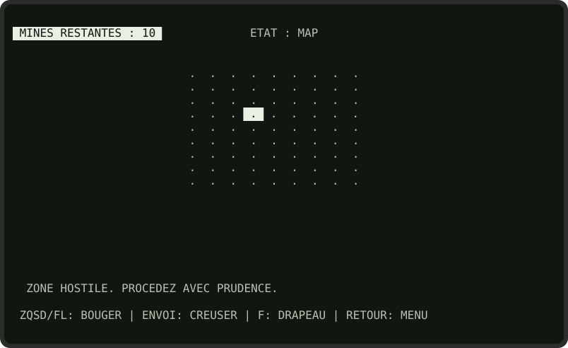<br><sub><b>Fig. 6.10</b> — MINITEL SWEEPER</sub></td>
<td align="center">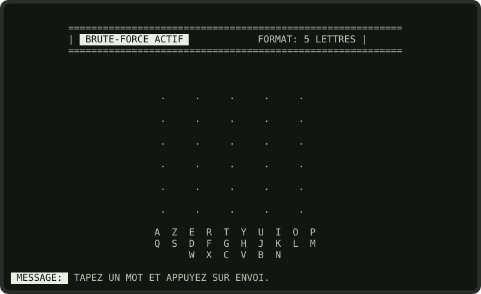<br><sub><b>Fig. 6.11</b> — 3615 DÉCRYPTAGE</sub></td>
</tr>
</table>

### 6.6 Multijoueur en ligne

**3615 BATAILLE NAVALE** (`bataille.lua`) — Duel en ligne contre un autre Minitel ou un navigateur web, ou entraînement contre l'Amiral IA. La flotte (5 navires, 14 cases) est placée au hasard ; `R` pour un autre placement.

<p align="center">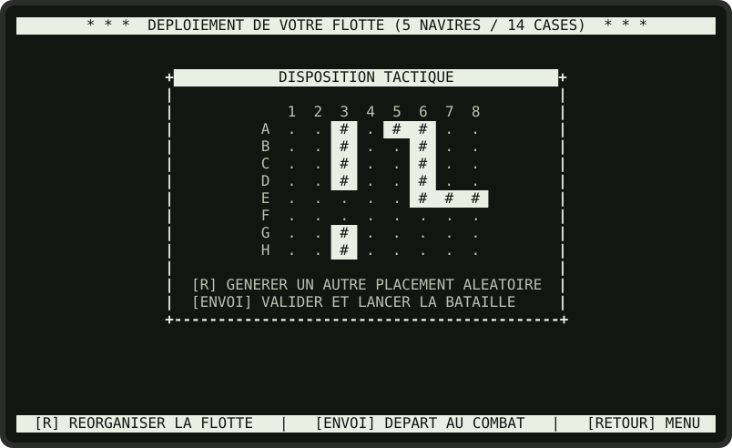<br><sub><b>Fig. 6.12</b> — Le déploiement de la flotte.</sub></p>

**3615 QUIZZ LIVE** (`quizz.lua`) — Jeu télévisé : plateau multijoueur en direct (Minitel, web, Discord) ou quizz solo infini avec des questions générées à la volée. Buzzez avec les touches `1` à `4`.

Ces deux jeux utilisent le serveur décrit au § 3.8 et le fichier `utils/pictochat.cfg`.

<div style="page-break-after: always;"></div>

## CHAPITRE 7 : LE LANGAGE MICRO-BASIC

Comme tout micro-ordinateur digne de ce nom, votre Minitel démarre... un BASIC. L'interpréteur **MICRO-BASIC TÉLÉTEL V6.1** (`utils/basic.lua`) se lance depuis **3615 OUTILS**.

<p align="center">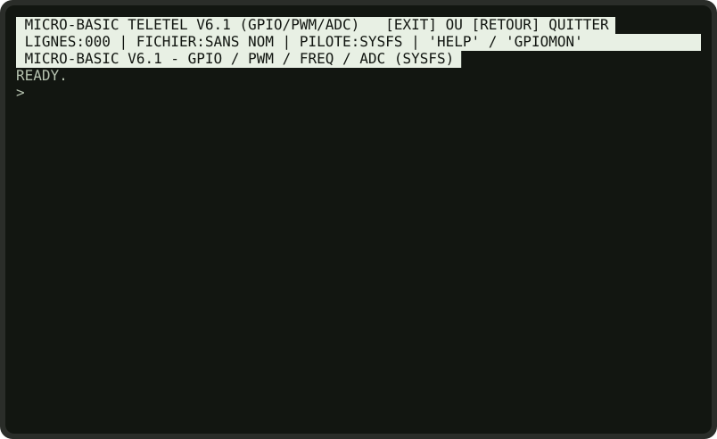<br><sub><b>Fig. 7.1</b> — L'invite du MICRO-BASIC.</sub></p>

* Programmes à **numéros de ligne**, édition directe, `LIST`, `RUN`, `SAVE`, `LOAD`.
* Boucles `FOR`…`NEXT` et `WHILE`…`WEND`, sous-programmes `GOSUB`, conditions `IF`…`THEN`…`ELSE`.
* Affichage : `CLS`, `LOCATE`, `INVERT`, `NORMAL` ; clavier temps réel avec `MKEY()`.
* **Entrées-sorties du Raspberry Pi** : `OUT`, `IN`, `TOGGLE`, `PULSE`, `PWM`, `FREQ`, `ADC`, `TEMP`, et un moniteur visuel des broches (`GPIOMON`).
* Une **syntaxe sans symboles** (`EQ`, `LT`, `GT`, `PLUS`, `FOIS`…) adaptée au clavier du Minitel.

Le langage dispose de son propre manuel, avec la référence complète de chaque instruction, le fonctionnement interne de l'interpréteur et une quinzaine de programmes commentés, du *Nombre mystère* au jeu d'arcade :

<div align="center">

### → [MANUEL DE PROGRAMMATION MICRO-BASIC](docs/MANUEL_BASIC.md)

</div>

<div style="page-break-after: always;"></div>

## CHAPITRE 8 : GUIDE DU DÉVELOPPEUR

### 8.1 Qu'est-ce qu'une cartouche ?

Une **cartouche** est un simple fichier Lua déposé dans `jeux/` ou dans `utils/`. Il n'y a rien à déclarer ailleurs : au prochain scan, le lanceur la trouve, lit ses métadonnées et l'ajoute à la liste. Pour la retirer, il suffit de supprimer le fichier.

Le lanceur exécute la cartouche avec `lua5.3`, depuis la racine du dépôt. Les chemins s'écrivent donc depuis cette racine : `require("minitel")` trouve le SDK, et un fichier de réglages s'appelle `jeux/mon_jeu.cfg`.

### 8.2 Les règles d'or

1. **Toujours** `minitel.init()` au début et `minitel.cleanup()` à la fin, faute de quoi le terminal reste en mode brut, sans curseur.
2. **80 colonnes, 24 lignes, ASCII pur.** Pas d'accents dans le texte affiché (`minitel.clean_accents()` pour les données venues d'Internet). Chaque ligne écrite doit tenir dans l'écran : un caractère en colonne 81 provoque un retour à la ligne qui décale tout.
3. **Delta-drawing.** Dessinez le squelette une fois, puis ne réécrivez que ce qui change. Utilisez `minitel.pad()` pour qu'une nouvelle valeur efface entièrement l'ancienne.
4. **Ne bloquez jamais.** Lisez le clavier avec `minitel.get_key()` dans une boucle, avec une petite pause (`minitel.sleep(0.01)` à `0.05`).
5. **Respectez les conventions** : `[RETOUR]` pour sortir ou ouvrir un menu, `[REPETITION]` pour tout redessiner, barre de touches en ligne 24.
6. **Mesurez le temps** avec `/proc/uptime` plutôt qu'avec `os.clock()`, qui compte le temps processeur et non le temps réel.

### 8.3 Exemple complet : 3615 CHRONO

Ce chronomètre au dixième de seconde met en pratique toutes les règles. Copiez-le dans `utils/chrono.lua`, puis appuyez sur `R` dans 3615 OUTILS.

```lua
-- @TYPE: OUTIL / CHRONOMETRE
-- @DESC: Chronometre au dixieme de seconde. Exemple complet du guide du developpeur.

local minitel = require("minitel")
minitel.init()

-- Horloge monotone en secondes (avec decimales), lue dans le noyau Linux
local function now()
    local f = io.open("/proc/uptime", "r")
    if f then
        local s = f:read("*l")
        f:close()
        return tonumber(s:match("^([%d%.]+)")) or os.time()
    end
    return os.time()
end

local running, start, elapsed = false, 0, 0
local last_shown = ""

local function draw_static()
    io.write("\x1b[r\x1b[2J\x1b[H")
    minitel.draw_window(20, 6, 40, 9, "3615 CHRONO")
    local footer = " [ESPACE] MARCHE/ARRET | [R] REMISE A ZERO | [RETOUR] QUITTER"
    io.write("\x1b[24;1H\x1b[7m" .. minitel.pad(footer, 80) .. "\x1b[0m")
    last_shown = ""   -- force le prochain affichage
end

local function draw_time()
    local t = elapsed + (running and (now() - start) or 0)
    local txt = string.format("%02d:%02d.%d",
        math.floor(t / 60), math.floor(t % 60), math.floor(t * 10) % 10)
    local state = running and "\x1b[7m EN MARCHE \x1b[0m" or "  ARRETE   "
    -- Delta-drawing : rien n'est envoye tant que l'affichage ne change pas
    if txt .. state ~= last_shown then
        io.write("\x1b[10;36H\x1b[1m" .. txt .. "\x1b[0m")
        io.write("\x1b[12;35H" .. state)
        io.flush()
        last_shown = txt .. state
    end
end

draw_static()
draw_time()

while true do
    local k = minitel.get_key()
    if k == "RETOUR" then
        break
    elseif k == " " then
        if running then elapsed = elapsed + (now() - start) else start = now() end
        running = not running
        minitel.play_sound("hit")
    elseif k == "r" or k == "R" then
        running, elapsed = false, 0
    elseif k == "REPETITION" then
        draw_static()
    end
    draw_time()
    minitel.sleep(0.05)
end

minitel.cleanup()
```

<p align="center">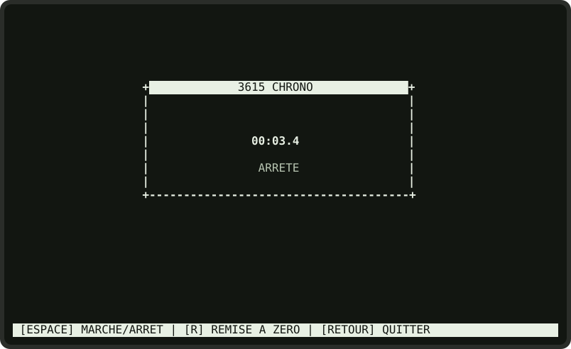<br><sub><b>Fig. 8.1</b> — La cartouche 3615 CHRONO en fonctionnement.</sub></p>

**Analyse.**
* Les **deux premières lignes** sont les métadonnées lues par le lanceur.
* `draw_static()` dessine le squelette : le cadre et la barre de touches. Elle n'est appelée qu'au démarrage et sur `[REPETITION]`.
* `draw_time()` est appelée vingt fois par seconde, mais n'envoie quelque chose au Minitel **que si le texte affiché change**, c'est-à-dire au plus dix fois par seconde, et seulement une vingtaine d'octets à chaque fois.
* La boucle principale ne bloque jamais : sans touche frappée, `get_key()` rend `nil` et le chronomètre continue de tourner.

### 8.4 Personnaliser le logo

Ajoutez les balises `@ART1` à `@ART5` dans l'en-tête (les cinq sont obligatoires). Chaque ligne est centrée dans la fiche du lanceur, sur 38 caractères au plus. Notez que les espaces situés juste après le deux-points sont ignorés : pour aligner un dessin, commencez chaque ligne par un caractère visible.

### 8.5 Mettre au point

* **Testez d'abord en mode PC** (§ 1.5) : c'est le même code, mais avec tous les outils de votre ordinateur.
* `lua5.3 -p ma_cartouche.lua` vérifie la syntaxe sans exécuter.
* Pour voir ce qu'un programme envoie réellement à l'écran, appuyez sur `Ctrl`+`P` : la capture texte est dans `screenshots/`.
* Le dossier `outils/` contient `diag.lua`, qui affiche le code de chaque touche frappée : pratique pour découvrir ce qu'envoie une touche spéciale de votre modèle de Minitel.

<div style="page-break-after: always;"></div>

## ANNEXE A : MÉMENTO DES SÉQUENCES VT100

Toutes les séquences commencent par l'octet `ESC` (27 en décimal, `1B` en hexadécimal, `\x1b` en Lua). La plupart continuent par `[` : on parle alors de séquence CSI.

| Séquence | Lua | Effet |
| :------- | :-- | :---- |
| `ESC [ l ; c H` | `"\x1b[10;5H"` | Placer le curseur ligne `l`, colonne `c`. |
| `ESC [ H` | `"\x1b[H"` | Curseur en haut à gauche. |
| `ESC [ 2 J` | `"\x1b[2J"` | Effacer tout l'écran. |
| `ESC [ K` | `"\x1b[K"` | Effacer de la position du curseur jusqu'au bout de la ligne. |
| `ESC [ 7 m` | `"\x1b[7m"` | Vidéo inverse. |
| `ESC [ 1 m` | `"\x1b[1m"` | Gras / surbrillance. |
| `ESC [ 0 m` | `"\x1b[0m"` | Retour aux attributs normaux. |
| `ESC [ h ; b r` | `"\x1b[3;24r"` | Zone de défilement de la ligne `h` à la ligne `b`. |
| `ESC [ r` | `"\x1b[r"` | Supprimer la zone de défilement (écran entier). |
| `ESC 7` / `ESC 8` | `"\x1b7"` / `"\x1b8"` | Mémoriser / restaurer la position du curseur. |
| `ESC [ s` / `ESC [ u` | `"\x1b[s"` / `"\x1b[u"` | Idem, variante ANSI. |
| `ESC [ n A` `B` `C` `D` | `"\x1b[3D"` | Déplacer le curseur de `n` cases (haut, bas, droite, gauche). |
| `ESC [ ? 25 l` / `h` | `"\x1b[?25l"` | Masquer / afficher le curseur. |

> **Attention.** D'après la norme VT100, définir une zone de défilement (`ESC[h;br`) **ramène le curseur en haut à gauche** de l'écran. Repositionnez toujours le curseur juste après.

## ANNEXE B : CODES CLAVIER

Codes ASCII des caractères imprimables, utiles pour décoder `MKEY()` en BASIC ou `string.byte()` en Lua :

```text
     32 espace   48 0    64 @    80 P     96 `    112 p
     33 !        49 1    65 A    81 Q     97 a    113 q
     34 "        50 2    66 B    82 R     98 b    114 r
     35 #        51 3    67 C    83 S     99 c    115 s
     36 $        52 4    68 D    84 T    100 d    116 t
     37 %        53 5    69 E    85 U    101 e    117 u
     38 &        54 6    70 F    86 V    102 f    118 v
     39 '        55 7    71 G    87 W    103 g    119 w
     40 (        56 8    72 H    88 X    104 h    120 x
     41 )        57 9    73 I    89 Y    105 i    121 y
     42 *        58 :    74 J    90 Z    106 j    122 z
     43 +        59 ;    75 K    91 [    107 k    123 {
     44 ,        60 <    76 L    92 \    108 l    124 |
     45 -        61 =    77 M    93 ]    109 m    125 }
     46 .        62 >    78 N    94 ^    110 n    126 ~
     47 /        63 ?    79 O    95 _    111 o
```

Codes de contrôle utiles : `8` Retour arrière, `13` Retour chariot (`[ENVOI]`), `16` `Ctrl`+`P` (impression), `27` Échap, `127` Suppression. Les noms renvoyés par `minitel.get_key()` pour les touches spéciales sont listés au § 2.3.

<div style="page-break-after: always;"></div>

## ANNEXE C : DÉPANNAGE

| Symptôme | Cause probable | Remède |
| :------- | :------------- | :----- |
| L'écran reste en 40 colonnes, caractères étranges | Le Minitel est encore en mode Vidéotex | Refaire la séquence du § 1.4 (`Ctrl`+`Esc`, `T`, `A`…). |
| Chaque touche s'affiche deux fois | L'écho local est actif | `Ctrl`+`Esc`, `T`, `E`. |
| Les flèches ne font rien | Clavier non étendu | `Ctrl`+`Esc`, `C`, `E`, ou utilisez `Z` `Q` `S` `D`. |
| Caractères incohérents en continu | Vitesses différentes entre le Minitel et le Pi | Régler le Minitel sur 9600 bauds. |
| Écran noir, rien ne se passe | Session non ouverte sur le port série | Vérifier que `/dev/ttyUSB0` existe (`ls /dev/ttyUSB*`) et que le service est actif : `systemctl status serial-getty@ttyUSB0`. |
| Rien n'arrive au Pi quand on tape | Fils TX / RX inversés, ou résistance de rappel manquante | Voir § 1.2. |
| Débris à l'écran après une perturbation | Octets perdus sur la ligne | Touche `[REPETITION]`. |
| Pas de son | SoX absent, sortie audio mal dirigée ou volume coupé | `sudo apt install sox` ; `raspi-config` > *Audio* > *Headphones* ; `alsamixer`. Testez avec `play -n synth 1 sine 440` (§ 2.6). |
| Son faible dans le haut-parleur du Minitel | Atténuation trop forte, ou réglage « Ampli ligne » bas | Réduisez la résistance de 10 kΩ, montez le volume ALSA, vérifiez « Ampli ligne » (§ 2.6). |
| Son saturé, grésillant | Signal trop fort pour l'entrée audio | Baissez le volume (`amixer sset Headphone 30%`) ou augmentez l'atténuation. |
| Ronflement continu | Boucle de masse, ou masse audio non câblée | Reliez la broche 8 à la masse du jack par son propre fil ; évitez de partager le fil de la broche 2. |
| L'entrée MISE À JOUR n'apparaît pas | Le `ping` vers `1.1.1.1` échoue | Vérifier le réseau avec CONFIG RÉSEAU ; l'état est retesté toutes les 30 s. |
| La mise à jour signale un « conflit local » | Des fichiers suivis par Git ont été modifiés sur le Pi | Choisir l'option 3 (renommer) pour garder vos versions, ou 1 pour revenir à l'officielle (§ 3.5). |
| Un programme a planté, le terminal est figé | `minitel.cleanup()` n'a pas été appelé | Taper `reset` à l'aveugle puis `[ENVOI]`, ou se déconnecter : la session se relance seule. |
| 3615 SANTE : « UNZIP ABSENT » | Paquet manquant | `sudo apt install unzip`. |

## ANNEXE D : GLOSSAIRE

| Terme | Définition |
| :---- | :--------- |
| **8N1** | Format série : 8 bits de données, pas de parité, 1 bit d'arrêt. |
| **ASCII** | Codage des caractères sur 7 bits (128 codes), sans accents. |
| **Baud** | Unité de rapidité de modulation ; ici, un bit par seconde. |
| **Cartouche** | Dans ce manuel, un programme Lua détecté automatiquement par un lanceur. |
| **CSI** | *Control Sequence Introducer* : la paire `ESC [` qui ouvre une séquence de commande. |
| **Delta-drawing** | Technique consistant à ne transmettre que les parties de l'écran qui ont changé. |
| **DIN** | Norme allemande de connecteurs ronds. La prise péri-informatique du Magis Club est une DIN à 8 broches, celle des premiers Minitel une DIN à 5 broches. |
| **Framebuffer** | Copie en mémoire du contenu de l'écran. |
| **GPIO** | *General Purpose Input/Output* : broches d'entrée-sortie programmables du Raspberry Pi. |
| **Magis Club** | Minitel haut de gamme construit par Alcatel pour France Télécom (révision 1 en 1996, révision 2 en 1999) : écran en niveaux de gris, lecteur de carte à puce, prise péri-informatique à 8 broches avec interface audio. |
| **Minitel** | Terminal télématique français diffusé par les PTT puis France Télécom de 1982 à 2012. |
| **PWM** | Modulation de largeur d'impulsion : un signal rapide dont on règle la proportion de temps à l'état haut. |
| **Prise péri-informatique** | Prise DIN à l'arrière du Minitel, prévue pour relier un périphérique ou un ordinateur. |
| **SoX** | *Sound eXchange* : boîte à outils audio en ligne de commande, utilisée ici comme synthétiseur. |
| **Télétel** | Le service de vidéotex français (les fameux 3615). |
| **Transpac** | Le réseau de transmission de données par paquets (norme X.25) qui transportait le Minitel. |
| **TTL** | Niveaux logiques 0 V / 5 V (ou 3,3 V), par opposition aux ±12 V du RS-232. |
| **VT100** | Terminal de DEC (1978) dont les séquences d'échappement sont devenues la norme ANSI. |
| **Vidéotex** | Mode d'affichage natif du Minitel : 40 colonnes, graphismes semi-graphiques. |


## ANNEXE E : RÉFÉRENCES

Les informations sur le matériel du Magis Club (brochage de la prise DIN 8, voie audio, vitesses du port série, haut-parleur) proviennent des sources suivantes :

* **Fiche constructeur Alcatel du Magis Club** — fonctions du terminal et rôle des trois broches audio : <https://www.minitel-alcatel.fr/Magis-Club.html>
* **MCbx, *Old Computer Collection*, « Magis Club »** — démontage d'un Magis Club révision 2 (1999), brochage relevé broche par broche, vitesses du port série : <https://oldcomputer.info/terminal/magis/index.htm>
* **Forum du Musée du Minitel, « Magis "de base" et Magis Club »** — différences entre modèles et révisions, réglages « Lumière » et « Ampli ligne » : <https://forum.museeminitel.fr/t/magis-de-base-et-magis-club-deux-fois-deux-modeles/225>
* **Forum du Musée du Minitel, « Une simple carte son »** — relier une carte son à la prise téléphonique d'un Minitel : <https://forum.museeminitel.fr/t/nouvelle-interface-de-connexion-du-minitel-une-simple-carte-son/1393>

---

<div align="center">

```text
 ============================================================
    FIN DU MANUEL DE REFERENCE - MINITEL MAGIS CLUB
    Suite : MANUEL DE PROGRAMMATION MICRO-BASIC (docs/)
 ============================================================
```

</div>
