<div align="center">

```text
  __  __ ___ ____ ____   ___        ____    _    ____ ___ ____
 |  \/  |_ _/ ___|  _ \ / _ \      | __ )  / \  / ___|_ _/ ___|
 | |\/| || | |   | |_) | | | |_____|  _ \ / _ \ \___ \| | |
 | |  | || | |___|  _ <| |_| |_____| |_) / ___ \ ___) | | |___
 |_|  |_|___\____|_| \_\\___/      |____/_/   \_\____/___\____|

              T E L E T E L   V 6 . 1
```

# MANUEL DE PROGRAMMATION MICRO-BASIC

**Pour le Minitel Magis Club en 80 colonnes et son coprocesseur Raspberry Pi**

*Édition 2026 — Second volume de la documentation*

</div>

<p align="center"></p>

---

### Avant-propos

`READY.` Ce mot, et le petit curseur qui clignote derrière, ont accueilli toute une génération devant son premier ordinateur. Le **MICRO-BASIC TÉLÉTEL** perpétue la tradition : allumez, tapez une ligne, appuyez sur `[ENVOI]`, et la machine obéit.

Ce manuel s'adresse à tous. Le **chapitre 1** vous fait écrire votre premier programme en cinq minutes. Les **chapitres 2 à 4** décrivent le langage en détail. Le **chapitre 5** ouvre le capot et explique comment l'interpréteur fonctionne, ce qui éclaire au passage toutes ses bizarreries. Le **chapitre 6** rassemble des programmes complets à taper, du plus simple au jeu d'arcade, et le **chapitre 7** vous apprend à piloter de vraies LED, de vrais boutons et de vrais capteurs branchés sur le Raspberry Pi.

Tous les programmes de ce manuel ont été **réellement exécutés** sur l'interpréteur, et les copies d'écran sont celles qu'ils ont produites.

> **Le premier volume**, le [Guide de l'utilisateur et manuel de référence technique](../README.md), décrit le reste du système et le matériel du Minitel Magis Club.

<div style="page-break-after: always;"></div>

## TABLE DES MATIÈRES

| Chapitre | Titre | Contenu |
| :------: | :---- | :------ |
| **1** | [Premiers pas](#chapitre-1--premiers-pas) | Démarrer, mode direct, saisir et corriger un programme, sauvegarder |
| **2** | [Les éléments du langage](#chapitre-2--les-éléments-du-langage) | Lignes, variables, nombres, expressions, vrai et faux |
| **3** | [Dictionnaire des instructions](#chapitre-3--dictionnaire-des-instructions) | Chaque instruction, sa syntaxe, ses exemples |
| **4** | [L'écran et le clavier](#chapitre-4--lécran-et-le-clavier) | Coordonnées, défilement, `MKEY()`, interruption |
| **5** | [Sous le capot](#chapitre-5--sous-le-capot--comment-fonctionne-linterpréteur) | Le fonctionnement interne de l'interpréteur |
| **6** | [Programmes à taper](#chapitre-6--programmes-à-taper) | Neuf programmes commentés, avec exercices |
| **7** | [Entrées-sorties matérielles](#chapitre-7--entrées-sorties-matérielles-gpio) | GPIO, PWM, fréquences, ADC, température |
| **8** | [Messages d'erreur](#chapitre-8--messages-derreur) | Ce qu'ils signifient, comment corriger |
| **A** | [Carte de référence](#annexe-a--carte-de-référence-rapide) | Tout le langage sur une page |
| **B** | [Mots réservés](#annexe-b--mots-réservés) | Les noms interdits pour les variables |
| **C** | [Différences avec les autres BASIC](#annexe-c--différences-avec-les-autres-basic) | Pour les programmeurs qui viennent d'ailleurs |

<div style="page-break-after: always;"></div>

## CHAPITRE 1 : PREMIERS PAS

### 1.1 Lancer le MICRO-BASIC

Depuis le portail, choisissez **3615 OUTILS**, puis **BASIC**. L'écran se présente ainsi :

```text
 Ligne 1   [ MICRO-BASIC TELETEL V6.1 (GPIO/PWM/ADC)  [EXIT] ... ]  <- bandeau
 Ligne 2   [ LIGNES:000 | FICHIER:SANS NOM | PILOTE:SYSFS | ...  ]  <- etat
 Ligne 3    READY.
 Ligne 4    > _                                                     <- invite
   ...
 Ligne 24          zone de travail (defilement des lignes 3 a 24)
```

Les **deux premières lignes** forment la barre d'état : nombre de lignes du programme en mémoire, nom du fichier (suivi d'un `*` s'il a été modifié depuis la dernière sauvegarde) et pilote matériel détecté pour les broches GPIO. Les **lignes 3 à 24** sont la zone de travail : quand elle est pleine, son contenu défile vers le haut, et la barre d'état reste en place.

Le signe **`>`** est l'**invite** : le BASIC attend vos ordres. Tout ce que vous tapez est **converti en majuscules**.

### 1.2 Le mode direct : une calculatrice

Tapez une instruction **sans numéro de ligne**, appuyez sur `[ENVOI]` : elle est exécutée immédiatement.

```basic
> PRINT "BONJOUR MINITEL"
BONJOUR MINITEL
> PRINT 2 + 2 * 10
22
> X = 7
> PRINT "X AU CARRE = " ; X * X
X AU CARRE = 49
```

Notez que la multiplication est faite avant l'addition (`2 + 20 = 22`), et que la variable `X` garde sa valeur d'une commande à l'autre.

### 1.3 Le mode programme : les numéros de ligne

Tapez maintenant une instruction **précédée d'un numéro**. Rien ne se passe à l'écran : la ligne est simplement **rangée en mémoire**, à sa place dans l'ordre des numéros.

```basic
> 10 CLS
> 20 FOR I = 1 TO 3
> 30 PRINT "LIGNE NUMERO " ; I
> 40 NEXT I
> LIST
10 CLS
20 FOR I = 1 TO 3
30 PRINT "LIGNE NUMERO " ; I
40 NEXT I
```

<p align="center">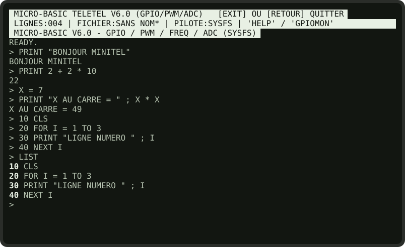<br><sub><b>Fig. 1.1</b> — Mode direct, puis saisie et liste d'un programme de quatre lignes.</sub></p>

`LIST` affiche le programme (numéros en gras). `RUN` l'exécute :

<p align="center">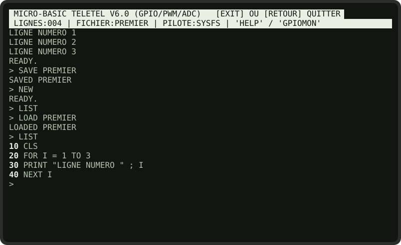<br><sub><b>Fig. 1.2</b> — <code>RUN</code>, puis <code>SAVE</code>, <code>NEW</code> (la mémoire est vide : <code>LIST</code> n'affiche rien) et <code>LOAD</code>.</sub></p>

> **Conseil de vieux routier.** Numérotez vos lignes **de 10 en 10**. Le jour où il faudra insérer une instruction entre la ligne 20 et la ligne 30, vous pourrez taper une ligne `25`.

### 1.4 Corriger un programme

| Pour… | Faites… |
| :---- | :------ |
| Remplacer une ligne | Retapez-la entière avec le même numéro. |
| Supprimer une ligne | Tapez son numéro seul : `30` puis `[ENVOI]`. |
| Insérer une ligne | Tapez-la avec un numéro intermédiaire (`25`). |
| Modifier une ligne sans tout retaper | `EDIT 30` : la ligne réapparaît, modifiable. |
| Tout effacer | `NEW` |

**L'éditeur de ligne.** Pendant la saisie d'une ligne (ou après `EDIT`), ces touches sont disponibles :

| Touche | Effet |
| :----- | :---- |
| `←` `→` | Déplacer le curseur dans la ligne ; on peut insérer du texte au milieu. |
| `[CORRECTION]` | Effacer le caractère à gauche du curseur. |
| `[ANNULATION]` | Effacer toute la ligne. |
| `[ENVOI]` | Valider. Après `EDIT`, une ligne vidée est supprimée. |
| `[RETOUR]` | Abandonner la saisie. |

<p align="center">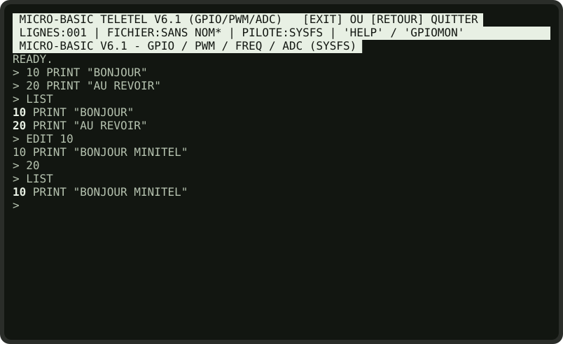<br><sub><b>Fig. 1.3</b> — <code>EDIT 10</code> : on recule d'un caractère et on insère « MINITEL » ; puis <code>20</code> seul supprime la ligne 20.</sub></p>

### 1.5 Sauvegarder et retrouver ses programmes

| Commande | Effet |
| :------- | :---- |
| `SAVE NOM` | Enregistre le programme dans `utils/prog_basic/NOM.bas`. Les guillemets sont facultatifs : `SAVE "NOM"` marche aussi. |
| `LOAD NOM` | Charge `utils/prog_basic/NOM.bas` (le programme et les variables en mémoire sont effacés). |
| `DIR` | Liste les programmes du dossier. |

<p align="center">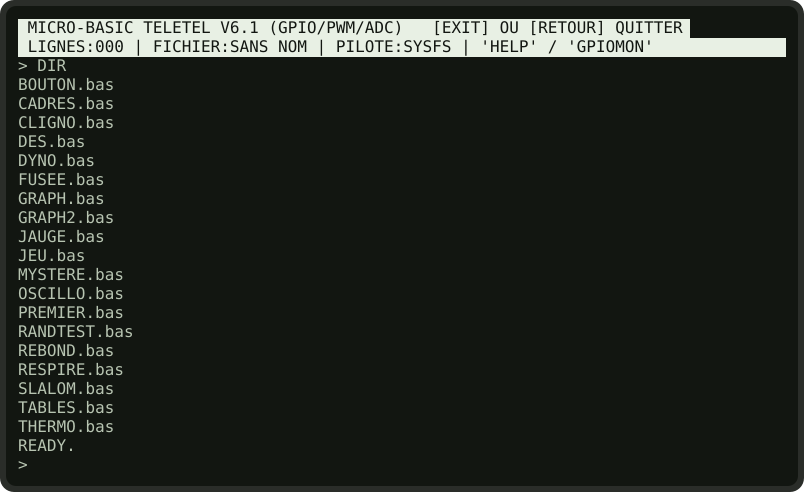<br><sub><b>Fig. 1.4</b> — <code>DIR</code> liste les fichiers <code>.bas</code>.</sub></p>

Un fichier `.bas` est un simple **fichier texte**, une instruction par ligne, précédée de son numéro. Vous pouvez donc écrire un long programme confortablement dans **MAGIS EDIT** (ou sur un autre ordinateur), l'enregistrer dans `utils/prog_basic/`, puis le charger avec `LOAD`.

> **Vos programmes survivent aux mises à jour.** Le programme de mise à jour du système met de côté les fichiers de `utils/prog_basic/` que vous avez créés ou modifiés, puis les remet en place après avoir téléchargé la nouvelle version. Même si celle-ci contient un programme du même nom, c'est le vôtre qui reste (voir le manuel du système, § 3.5).

> **Attention aux majuscules.** Linux distingue majuscules et minuscules dans les noms de fichiers, et le BASIC convertit tout ce que vous tapez en majuscules. Un fichier nommé `jeu.bas` ne pourra pas être chargé : nommez vos fichiers **en majuscules** (`JEU.bas`, l'extension restant en minuscules).

### 1.6 Quitter

Tapez `EXIT` (ou `QUIT`), ou appuyez sur `[RETOUR]` **à une invite vide**. Si le programme en mémoire a été modifié depuis la dernière sauvegarde, `[RETOUR]` demande d'abord confirmation. Tous les signaux PWM en cours sont coupés.

<p align="center">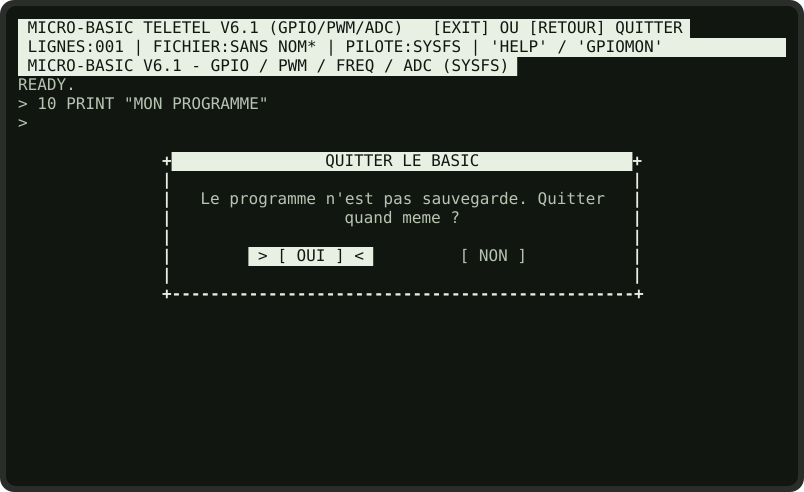<br><sub><b>Fig. 1.5</b> — <code>[RETOUR]</code> avec un programme non sauvegardé : le BASIC demande confirmation.</sub></p>

`[RETOUR]` au milieu d'une ligne en cours de saisie se contente d'abandonner cette ligne. **Le programme en mémoire n'est pas sauvegardé automatiquement** : pensez à `SAVE` avant de partir.

<div style="page-break-after: always;"></div>

## CHAPITRE 2 : LES ÉLÉMENTS DU LANGAGE

### 2.1 Les lignes

* Un numéro de ligne est un **entier positif**. À l'exécution, les lignes sont parcourues **dans l'ordre croissant des numéros**, quel que soit l'ordre dans lequel vous les avez tapées.
* Chaque ligne contient **une seule instruction**. Le séparateur `:` des autres BASIC n'existe pas.
* Les espaces entre les mots sont nécessaires (`FOR I = 1 TO 10`, pas `FORI=1TO10`).

### 2.2 Les variables

Une variable est une case mémoire nommée qui contient **un nombre**.

```basic
10 SCORE = 0
20 VIES = 3
30 SCORE = SCORE + 10
40 PRINT "SCORE : " ; SCORE ; "  VIES : " ; VIES
```

| Règle | Détail |
| :---- | :----- |
| **Nom** | Uniquement des **lettres** : `X`, `DX`, `SCORE`, `VITESSE`. **Pas de chiffres** : `A1` ou `X2` ne sont pas des noms valides. |
| **Contenu** | Uniquement des **nombres** (entiers ou décimaux). Il n'y a pas de variables texte (`A$`) ni de tableaux (`DIM`). |
| **Valeur initiale** | Une variable jamais affectée vaut **0**. |
| **Portée** | Toutes les variables sont globales, partagées entre le programme principal et les sous-programmes. |
| **Durée de vie** | Elles survivent à la fin du programme et à un nouveau `RUN`. Seuls `NEW`, `CLEAR` et `LOAD` les effacent. |

> **Piège classique.** Comme `RUN` ne remet pas les variables à zéro, un programme qui suppose « `S` vaut 0 au départ » fonctionnera la première fois, puis plus du tout. **Initialisez toujours vos variables** en début de programme (`10 S = 0`).

L'affectation s'écrit `X = 5`, `LET X = 5` ou, sans symbole, `X EQ 5`.

### 2.3 Les nombres et leur affichage

Le BASIC calcule avec les nombres de Lua 5.3. `PRINT` affiche un nombre sans décimales quand il tombe juste, et avec ses décimales sinon :

| Calcul | Affichage | Remarque |
| :----- | :-------- | :------- |
| `PRINT 3 * 4` | `12` | |
| `PRINT 7 / 2` | `3.5` | |
| `PRINT 4 / 2` | `2` | La division tombe juste : pas de décimales. |
| `PRINT INT(7 / 2)` | `3` | `INT` ramène à l'entier inférieur. |
| `PRINT 2 ^ 10` | `1024` | |
| `PRINT 10 / 3` | `3.3333333333333` | 14 chiffres significatifs au plus. |
| `PRINT 1 / 0` | `inf` | L'infini, et non une erreur. |

> **Pour arrondir**, passez les résultats par `INT()` : `PRINT INT(S / N)` donne la partie entière ; `INT(X + 0.5)` arrondit au plus proche.

### 2.4 Les expressions

Une expression combine nombres, variables, opérateurs et fonctions : `X * 2 + 1`, `INT(SIN(A) * 8)`, `(C * R) / 7024`.

**Opérateurs arithmétiques**

| Symbole | En toutes lettres | Opération | Exemple | Résultat |
| :-----: | :---------------- | :-------- | :------ | :------- |
| `+` | `PLUS` | Addition | `7 + 2` | `9` |
| `-` | `MOINS`, `MINUS` | Soustraction | `7 - 2` | `5` |
| `*` | `FOIS`, `MUL` | Multiplication | `7 * 2` | `14` |
| `/` | `DIV` | Division | `7 / 2` | `3.5` |
| — | `MOD` | Reste de la division | `17 MOD 5` | `2` |
| `^` | — | Puissance | `2 ^ 3` | `8` |

**Opérateurs de comparaison** (ils donnent 1 pour vrai, 0 pour faux)

| À écrire | Signification | Remarque |
| :------: | :------------ | :------- |
| `=` ou `EQ` | égal | `IF X = 5` et `IF X EQ 5` sont équivalents. |
| `<` ou `LT` | inférieur | |
| `>` ou `GT` | supérieur | |
| `<=` ou `LE` | inférieur ou égal | |
| `>=` ou `GE` | supérieur ou égal | |
| `<>` ou `NEQ` | différent | |

Les formes en toutes lettres évitent de chercher les symboles sur le clavier du Minitel.

**Opérateurs logiques** : `AND`, `OR`, `NOT`.

**Priorités**, de la plus forte à la plus faible : `^` ; puis `NOT` et le signe moins ; puis `*` `/` `MOD` ; puis `+` `-` ; puis les comparaisons ; puis `AND` ; enfin `OR`. Dans le doute, **mettez des parenthèses** : `IF NOT (X EQ 1) THEN …`.

**Fonctions**

| Fonction | Résultat | Exemple |
| :------- | :------- | :------ |
| `RND(N)` | Entier au hasard entre 1 et N (inclus) | `RND(6)` : un dé |
| `INT(X)` | Partie entière, **arrondie vers le bas** | `INT(3.7)` = 3, `INT(-2.5)` = -3 |
| `ABS(X)` | Valeur absolue | `ABS(0 - 3)` = 3 |
| `SQR(X)` | Racine carrée | `SQR(2)` = 1.4142135623731 |
| `SIN(X)` `COS(X)` `TAN(X)` | Trigonométrie, angle en **radians** | `SIN(PI / 2)` = 1 |
| `EXP(X)` `LOG(X)` | Exponentielle, logarithme népérien | `LOG(EXP(1))` = 1 |
| `PI` | 3,14159… (sans parenthèses) | `2 * PI` |
| `MKEY()` ou `MKEY` | Touche pressée, sans attendre (chapitre 4) | `K = MKEY()` |
| `TEMP` ou `TEMP()` | Température du processeur en °C | `T = TEMP` |
| `IN(P)` ou `IN P` | État d'une broche GPIO, 0 ou 1 (chapitre 7) | `IF IN 27 EQ 0 THEN …` |
| `ADC(C)` ou `ADC C` | Valeur d'un canal analogique (chapitre 7) | `V = ADC 0` |

### 2.5 Le vrai et le faux

Une comparaison vaut **1** si elle est vraie et **0** si elle est fausse. On peut l'afficher, ou la ranger dans une variable :

```basic
> X = 3
> PRINT X EQ 3
1
```

L'instruction `IF` exécute sa partie `THEN` quand la condition **vaut autre chose que 0**.

> **Subtilité de `AND`, `OR` et `NOT`.** Ces opérateurs ne fonctionnent correctement **qu'entre des comparaisons**. Écrivez `IF X GT 1 AND X LT 5`, et jamais `IF A AND B` avec de simples nombres : en interne, le nombre 0 n'est pas considéré comme « faux » par ces opérateurs (chapitre 5). Pour tester une variable, comparez-la : `IF A NEQ 0 AND B NEQ 0`.

### 2.6 Les erreurs dans les expressions

Une expression mal formée (`2 + * 3`, parenthèse manquante, mot réservé employé comme variable) ou impossible à calculer (`(X GT 1) + 1`) arrête le programme sur un **`SYNTAX ERROR`**, avec le numéro de la ligne fautive (chapitre 8).

> **Nouveautés de la version V6.1.** La version précédente de l'interpréteur avait quatre défauts qui ne provoquaient aucun message. Si vous reprenez un ancien programme, voici ce qui a changé :
> * `<=`, `>=` et `<>` étaient toujours faux : ils fonctionnent désormais, comme `LE`, `GE` et `NEQ` ;
> * `5-N` avec `N` négatif donnait un résultat faux : le calcul est désormais exact, avec ou sans espaces ;
> * `MKEY()` avec parenthèses renvoyait toujours 0 (seule la forme `MKEY` fonctionnait) : les deux formes marchent désormais ;
> * une expression incorrecte valait 0 sans prévenir : elle provoque désormais un `SYNTAX ERROR`.
>
> La V6.1 affiche aussi `4 / 2` comme `2` au lieu de `2.0`. Elle n'écrit plus par-dessus la barre d'état au lancement d'un programme sans `CLS`. Enfin, `[RETOUR]` à une invite vide quitte le BASIC, comme l'annonce le bandeau.

<div style="page-break-after: always;"></div>

## CHAPITRE 3 : DICTIONNAIRE DES INSTRUCTIONS

Conventions : les mots en `MAJUSCULES` sont à taper tels quels ; `expr` désigne une expression, `var` un nom de variable, `n` un numéro de ligne. Les crochets `[ ]` entourent une partie facultative.

### 3.1 Commandes de l'interpréteur

Ces commandes se tapent à l'invite, sans numéro de ligne.

| Commande | Effet |
| :------- | :---- |
| `RUN` | Exécute le programme depuis sa plus petite ligne. `[RETOUR]` l'interrompt. |
| `LIST` | Affiche tout le programme, dans l'ordre des numéros. |
| `NEW` | Efface le programme **et** les variables, coupe les signaux PWM. |
| `CLEAR` | **Identique à `NEW`** : efface aussi le programme. (Dans d'autres BASIC, `CLEAR` n'efface que les variables. Méfiance !) |
| `EDIT n` | Rappelle la ligne `n` pour la modifier (§ 1.4). |
| `SAVE NOM` | Sauvegarde dans `utils/prog_basic/NOM.bas`. |
| `LOAD NOM` | Charge `utils/prog_basic/NOM.bas`. |
| `DIR` | Liste les programmes sauvegardés. |
| `HELP` ou `GUIDE` | Aide-mémoire intégré, à faire défiler avec `Z`/`S` ou les flèches. |
| `GPIOMON` | Moniteur des broches GPIO, des PWM et des entrées analogiques (§ 7.6). |
| `EXIT` ou `QUIT` | Quitte le MICRO-BASIC. |

<p align="center">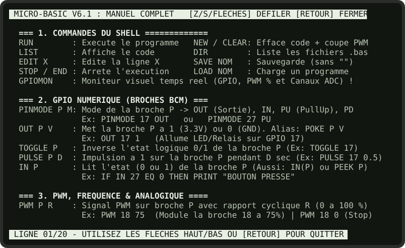<br><sub><b>Fig. 3.1</b> — L'aide-mémoire intégré (<code>HELP</code>).</sub></p>

### 3.2 Affichage

#### `PRINT` — afficher

```text
PRINT element [ ; element ... ] [ ; ]
```

Affiche des textes entre guillemets et des valeurs d'expressions, **séparés par des points-virgules**. Les éléments sont collés les uns aux autres : prévoyez les espaces dans les textes. Sans point-virgule final, le curseur passe à la ligne suivante ; avec un point-virgule final, il reste en place, et le prochain `PRINT` écrira à la suite.

```basic
10 PRINT "TOTAL : " ; A + B ; " FRANCS"
20 PRINT "SUR LA MEME LIGNE " ;
30 PRINT "QUE CECI"
40 PRINT ""
```

`PRINT ""` affiche une ligne vide. La virgule n'est **pas** un séparateur : `PRINT X , Y` n'affiche que `X`.

#### `CLS` — effacer l'écran

Efface l'écran, redessine la barre d'état et place le curseur en haut de la zone de travail (colonne 1, ligne 3). Un programme qui commence par `CLS` démarre sur un écran propre.

#### `LOCATE x, y` — positionner le curseur

Place le curseur en colonne `x` (1 à 80), ligne `y` (1 à 24). Le prochain `PRINT` écrira à cet endroit. Les valeurs hors limites sont ramenées dans l'écran. La virgule est facultative (`LOCATE 10 5`), mais **obligatoire dès que les coordonnées sont des expressions** contenant des espaces : `LOCATE X + 2, Y`.

```basic
10 CLS
20 LOCATE 35, 12
30 PRINT "AU MILIEU" ;
```

#### `INVERT` et `NORMAL` — vidéo inverse

`INVERT` fait passer tout ce qui suit en **vidéo inverse** (fond clair, texte sombre) ; `NORMAL` revient à l'affichage ordinaire. Un espace en vidéo inverse donne un pavé plein : c'est ainsi qu'on dessine des barres et des jauges.

```basic
10 INVERT
20 PRINT " ATTENTION " ;
30 NORMAL
```

#### `BEEP` — bip sonore

Émet un bip court (880 Hz), synthétisé par le Raspberry Pi et diffusé par le haut-parleur du Minitel grâce à la voie audio de la prise péri-informatique. Le programme n'attend pas la fin du son.

### 3.3 Variables et calcul

#### `LET` — affecter une valeur

```text
[LET] var = expr        ou        [LET] var EQ expr
```

Le mot `LET` est facultatif. `X = X + 1` augmente `X` de 1.

#### `REM` — remarque

Tout ce qui suit `REM` est ignoré. Servez-vous-en pour titrer votre programme et expliquer les passages délicats. `REM` coûte un peu de temps à l'exécution : évitez d'en placer au cœur d'une boucle rapide.

### 3.4 Clavier et temps

#### `INPUT var` — demander un nombre

Affiche `? `, attend que l'utilisateur tape un nombre et `[ENVOI]`, puis le range dans `var`. Une seule variable par `INPUT`. Si la saisie n'est pas un nombre, la variable reçoit **0**. `[RETOUR]` pendant la saisie interrompt le programme.

```basic
10 PRINT "VOTRE AGE " ;
20 INPUT A
30 PRINT "DANS 10 ANS VOUS AUREZ " ; A + 10 ; " ANS"
```

#### `MKEY()` — lire le clavier sans attendre

Fonction (et non instruction) : `K = MKEY()`, ou `K = MKEY`, range dans `K` le code de la dernière touche pressée, ou **0** si aucune ne l'a été. Le programme ne s'arrête pas. Codes détaillés au § 4.4.

#### `PAUSE secondes` — attendre

Suspend le programme. Les décimales sont permises (`PAUSE 0.05`). À partir d'un dixième de seconde, la pause peut être interrompue par `[RETOUR]`, et une autre touche frappée pendant l'attente est gardée pour le prochain `MKEY()`.

### 3.5 Contrôle du déroulement

#### `GOTO n` — sauter

Poursuit l'exécution à la ligne `n`. Le numéro peut être une expression (`GOTO 100 + K * 10`), ce qui permet des aiguillages (§ 5.5).

#### `IF condition THEN instruction [ELSE instruction]` — condition

Si la condition vaut autre chose que 0, exécute l'instruction placée après `THEN` ; sinon, celle placée après `ELSE`, s'il y en a une.

```basic
10 IF X GT 100 THEN PRINT "TROP GRAND" ELSE PRINT "CA VA"
20 IF V EQ 0 THEN GOTO 500
30 IF X LT 5 THEN IF Y LT 5 THEN PRINT "COIN EN BAS A GAUCHE"
```

* Après `THEN`, il faut une **instruction** : écrivez `THEN GOTO 500`, et non `THEN 500`.
* On peut imbriquer les `IF` (ligne 30).
* Pour exécuter plusieurs instructions, appelez un sous-programme : `IF … THEN GOSUB 200`.

#### `FOR var = début TO fin` … `NEXT var` — boucle comptée

```basic
10 FOR I = 1 TO 5
20 PRINT I ; " " ;
30 NEXT I
```

affiche `1 2 3 4 5`. La variable augmente de 1 à chaque passage.

* **Il n'y a pas de `STEP`** : le pas est toujours de 1. Pour un autre pas, modifiez la variable dans la boucle : `R = R + 499` avant `NEXT R` donne un pas de 500 (voir le programme DYNO).
* La borne `fin` est calculée **une seule fois**, au départ.
* Le corps de la boucle est **toujours exécuté au moins une fois**, même si `début` dépasse déjà `fin`.
* Le `NEXT` doit nommer la variable de la boucle : `NEXT I`.
* À la sortie, la variable vaut `fin + 1`.
* Les boucles s'imbriquent (programme TABLES).

#### `WHILE condition` … `WEND` — boucle conditionnelle

Répète les lignes comprises entre `WHILE` et `WEND` **tant que** la condition est vraie. La condition est testée avant chaque passage : si elle est fausse dès le départ, le corps n'est jamais exécuté.

```basic
10 N = 10
20 WHILE N GT 0
30 PRINT N
40 N = N - 1
50 WEND
```

#### `GOSUB n` … `RETURN` — sous-programme

`GOSUB n` saute à la ligne `n` en retenant d'où il est parti ; `RETURN` revient à la ligne qui suit le `GOSUB`. Les sous-programmes peuvent en appeler d'autres. Les « paramètres » se passent par des variables, fixées avant l'appel (programme CADRES).

```basic
10 GOSUB 1000
20 PRINT "DE RETOUR"
30 END
1000 PRINT "DANS LE SOUS-PROGRAMME"
1010 RETURN
```

> Placez vos sous-programmes après un `END`, aux grands numéros (1000, 2000…), pour que le programme principal ne tombe pas dedans par mégarde.

#### `END` et `STOP` — terminer

`END` arrête le programme sans rien dire. `STOP` l'arrête en affichant `PROGRAM STOPPED AT LINE n` : pratique pour mettre au point, en examinant ensuite les variables en mode direct (`PRINT X`). Un programme s'arrête aussi tout seul après sa dernière ligne.

<div style="page-break-after: always;"></div>

## CHAPITRE 4 : L'ÉCRAN ET LE CLAVIER

### 4.1 Les coordonnées

```text
          colonne 1                                                      colonne 80
             |                                                               |
 ligne  1    MICRO-BASIC TELETEL V6.1 ...                (barre d'etat)
 ligne  2    LIGNES:012 | FICHIER:...                    (barre d'etat)
 ligne  3    +---------------------------------------------------------------+
     .       |                                                               |
     .       |        zone de travail : LOCATE 1..80, 3..24                  |
     .       |                                                               |
 ligne 24    +---------------------------------------------------------------+
```

`LOCATE x, y` : **x d'abord (la colonne, de gauche à droite), y ensuite (la ligne, de haut en bas)**. Les lignes 1 et 2 sont accessibles, mais la barre d'état y est redessinée à chaque `CLS` et à chaque retour à l'invite.

### 4.2 Le défilement

La zone de travail (lignes 3 à 24) est une **zone de défilement** : quand un `PRINT` passe à la ligne alors que le curseur est déjà sur la ligne 24, tout le contenu de la zone monte d'un cran. C'est le Minitel lui-même qui fait glisser les lignes : l'opération est quasi instantanée. Le programme SLALOM exploite cette propriété pour faire défiler une route.

> **Au lancement d'un programme.** `RUN` redéfinit la zone de défilement. D'après la norme VT100, cette opération ramène le curseur en haut à gauche de l'écran, sur la barre d'état : l'interpréteur mémorise donc la position du curseur juste avant et la restaure juste après. Un programme sans `CLS` écrit à la suite de la commande `RUN`.

### 4.3 Animer sans clignoter

Une liaison à 9600 bauds transmet environ 960 caractères par seconde. Pour qu'une animation soit fluide, n'effacez jamais l'écran entier entre deux images : **effacez seulement l'ancien dessin** (en réécrivant un espace par-dessus) et **dessinez le nouveau**. C'est exactement ce que fait le programme REBOND :

```basic
110 LOCATE X, Y
120 PRINT " " ;        efface la balle a l'ancienne position
130 X = X + DX
140 Y = Y + DY
190 LOCATE X, Y
200 PRINT "O" ;        dessine la balle a la nouvelle position
```

Terminez ces `PRINT` par un **point-virgule** : un passage à la ligne ferait défiler l'écran si le curseur se trouve en ligne 24.

### 4.4 Le clavier en temps réel : `MKEY()`

`MKEY()` renvoie immédiatement le code de la dernière touche pressée, ou 0.

| Touche | Code renvoyé |
| :----- | :----------: |
| Aucune touche | **0** |
| Flèche ↑, ou `Z` | **200** |
| Flèche ↓, ou `S` | **201** |
| Flèche ←, ou `Q` | **202** |
| Flèche →, ou `D` | **203** |
| `[ENVOI]` | **13** |
| `[RETOUR]` | **27** |
| Toute autre touche | Son code ASCII (`A` = 65, espace = 32, `1` = 49…) |

* Les lettres **`Z` `Q` `S` `D`** (majuscules ou minuscules) sont **assimilées aux flèches** : c'est la disposition des jeux sur clavier AZERTY. Un programme ne peut donc pas les lire comme des lettres.
* Pour les autres lettres, la minuscule et la majuscule ont des codes différents (`a` = 97, `A` = 65). Testez les deux : `IF K EQ 65 OR K EQ 97 THEN …`.
* Entre deux lignes du programme, l'interpréteur jette un œil au clavier pour détecter `[RETOUR]`. Une autre touche frappée à ce moment n'est pas perdue : elle est mise de côté pour le prochain `MKEY()`.

Squelette d'une boucle de jeu :

```basic
100 K = MKEY()
110 IF K EQ 202 THEN X = X - 1
120 IF K EQ 203 THEN X = X + 1
130 REM ... deplacer, dessiner, tester les collisions ...
140 GOTO 100
```

### 4.5 Interrompre un programme

Appuyez sur **`[RETOUR]`** (ou Échap sur un clavier de PC) : le programme s'arrête à la fin de la ligne en cours et affiche `BREAK IN n`. Les variables gardent leurs valeurs : vous pouvez les examiner en mode direct, puis relancer avec `RUN`.

<p align="center">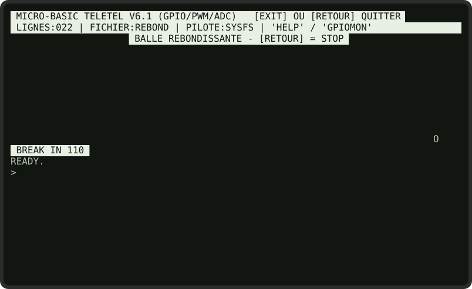<br><sub><b>Fig. 4.1</b> — Le programme REBOND interrompu par <code>[RETOUR]</code> pendant la ligne 170.</sub></p>

<div style="page-break-after: always;"></div>

## CHAPITRE 5 : SOUS LE CAPOT — COMMENT FONCTIONNE L'INTERPRÉTEUR

Le MICRO-BASIC est écrit en Lua, dans le fichier `utils/basic.lua` (environ 1 000 lignes). Connaître sa mécanique permet d'écrire des programmes plus rapides, et de comprendre pourquoi il se comporte comme il le fait.

### 5.1 Le programme en mémoire

Le programme est rangé dans un **tableau associatif** Lua : à chaque numéro de ligne correspond le texte de l'instruction.

```text
   program[10] = "CLS"
   program[20] = "FOR I = 1 TO 3"
   program[30] = "PRINT \"LIGNE NUMERO \" ; I"
   program[40] = "NEXT I"
```

Taper une ligne numérotée l'ajoute ou la remplace ; taper un numéro seul la supprime. Rien n'est analysé à ce moment-là : une faute de syntaxe ne sera détectée qu'à l'exécution de la ligne.

### 5.2 Le cycle d'exécution

Au `RUN`, l'interpréteur trie les numéros de ligne dans une liste, puis fait avancer un **compteur ordinal** (`pc`) qui désigne la prochaine ligne à exécuter :

```text
   +--> le joueur a-t-il appuye sur [RETOUR] ?  -- oui -->  "BREAK IN n", fin
   |              | non
   |              v
   |    executer la ligne pointee par pc
   |              |
   |              v
   |    selon le resultat :
   |      "OK"            -> pc = pc + 1
   |      "GOTO" / "GOSUB"-> chercher la ligne cible dans la liste triee
   |      "FOR" / "NEXT"  -> gerer la pile des boucles
   |      "RETURN"        -> depiler l'adresse de retour
   |      "END" / erreur  -> fin
   |              |
   |    petite pause de 5 millisecondes
   +--------------+
```

**Les piles.** Deux piles mémorisent l'état des structures en cours :

* la **pile des boucles** garde, pour chaque `FOR` actif, le nom de la variable, la borne et la position de la ligne `FOR` ; pour chaque `WHILE` actif, la position de la ligne `WHILE` ;
* la **pile des `GOSUB`** garde les positions de retour.

Un `NEXT I` augmente `I` de 1, compare à la borne, et selon le cas revient à la ligne qui suit le `FOR` ou dépile. Un `WEND` dépile et revient sur le `WHILE`, qui réévalue sa condition. C'est pourquoi le corps d'une boucle `FOR` est toujours exécuté au moins une fois : le test n'a lieu qu'au `NEXT`.

### 5.3 L'évaluation des expressions : la traduction en Lua

Le MICRO-BASIC ne contient pas de calculateur d'expressions à proprement parler. Il **traduit l'expression en Lua**, puis demande à Lua de la calculer. Suivons `X GT 1 AND X LT 5`, avec `X` valant 3 :

```text
  1. Mise en majuscules           X GT 1 AND X LT 5
  2. Raccourcis sans parentheses  (IN 27 -> IN(27), ADC 0 -> ADC(0), MKEY -> MKEY())
  3. Symboles de comparaison      "=" devient "==" ; "<>" devient "~="
  4. Mots, un par un :
       mots-operateurs  GT -> >   LT -> <   EQ -> ==   PLUS -> +   MOD -> % ...
       fonctions        SIN -> sin   INT -> floor   RND -> hasard ...
       variables        remplacees par LEUR VALEUR, ecrite en toutes lettres
                                  3 > 1 and 3 < 5
  5. Execution par Lua            true
  6. Conversion                   vrai -> 1, faux -> 0           resultat : 1
```

Cette méthode, simple et compacte, explique tous les comportements particuliers du langage :

* **Les variables ne contiennent que des nombres** : leur valeur est recopiée telle quelle dans le texte de l'expression.
* **Les noms de variables n'ont pas de chiffres** : l'étape 4 découpe l'expression en suites de lettres. Dans `A1`, elle voit la variable `A` suivie du nombre `1`.
* **Les valeurs négatives sont mises entre parenthèses** : avec `N` valant -2, `5-N` devient `5-(-2)`. Sans cette précaution, on obtiendrait `5--2`, et en Lua `--` ouvre un **commentaire** : Lua lirait simplement `5`. C'était l'un des défauts de la version V6.0.
* **Les symboles à deux caractères sont protégés** : l'étape 3 doit transformer le `=` du BASIC en `==` de Lua, sans toucher au `=` de `<=` ou de `>=`. L'interpréteur met donc d'abord `<=`, `>=`, `<>` et `==` de côté, double les `=` restants, puis remet les symboles en place. La version V6.0 doublait tous les `=`, si bien que `<=` devenait `<==`, que Lua refusait.
* **Une expression que Lua refuse est une erreur** : l'interpréteur le signale par `SYNTAX ERROR`. En V6.0, elle valait 0 sans prévenir, ce qui masquait les défauts précédents, ainsi qu'un quatrième : `MKEY()` était traduit en `mkey() ()`, un appel invalide, et renvoyait donc toujours 0.
* **`AND` et `OR` entre nombres** : en Lua, seuls `false` et `nil` sont faux ; le nombre 0 est vrai. `0 AND 1` vaut donc 1 pour Lua. Les comparaisons, elles, produisent de vrais `true` et `false`, d'où le conseil du § 2.5.
* **Un calcul mélangeant comparaison et arithmétique**, comme `(X GT 1) + 1`, provoque un `SYNTAX ERROR` : Lua refuse d'additionner `true` et 1.

### 5.4 La vitesse

Le temps d'exécution est dominé par une **pause de 5 millisecondes après chaque ligne**, réalisée en lançant la commande `sleep` du système. Elle évite que l'interpréteur n'accapare le processeur et lui laisse le temps de surveiller le clavier.

| Mesure | Résultat |
| :----- | :------- |
| Boucle vide `FOR I = 1 TO 500` / `NEXT I` (1 000 lignes exécutées) | **4,2 secondes** sur un PC récent, soit environ **240 lignes par seconde** |
| Sur Raspberry Pi | Plus lent : lancer un processus y coûte davantage. Comptez de l'ordre d'une centaine de lignes par seconde. |

C'est la vitesse d'un micro-ordinateur 8 bits des années 1980. Les mêmes recettes s'appliquent :

* **Comptez les lignes, pas les instructions** : chaque ligne coûte le même temps fixe, quelle que soit sa complexité. Une expression longue sur une ligne vaut mieux que trois lignes courtes.
* **Sortez des boucles** tout ce qui peut l'être (calculs constants, `REM`).
* **Évitez les `GOTO` lointains dans les boucles rapides** : pour trouver la ligne cible, l'interpréteur parcourt la liste des lignes depuis le début.
* **L'affichage reste le vrai goulot** : 960 caractères par seconde au plus vers le Minitel. Un programme qui affiche beaucoup est limité par la liaison avant de l'être par l'interpréteur.

### 5.5 Astuce : l'aiguillage calculé

Le BASIC n'a pas d'instruction `ON … GOTO`, mais `GOTO` accepte une expression. Pour aiguiller selon la valeur de `C` (1, 2 ou 3) :

```basic
100 GOTO 1000 + C * 100
1100 PRINT "CHOIX UN"
1110 GOTO 2000
1200 PRINT "CHOIX DEUX"
1210 GOTO 2000
1300 PRINT "CHOIX TROIS"
2000 END
```

Si la ligne calculée n'existe pas, le programme s'arrête sur `UNDEFINED LINE`.

<div style="page-break-after: always;"></div>

## CHAPITRE 6 : PROGRAMMES À TAPER

Neuf programmes complets, classés par difficulté (★ à ★★★). Tapez-les ligne par ligne à l'invite, ou dans MAGIS EDIT (§ 1.5). Chacun est suivi d'une explication et d'idées pour aller plus loin.

### 6.1 LE NOMBRE MYSTÈRE ★

*`INPUT`, `IF`, `GOTO`, compteur.* L'ordinateur choisit un nombre entre 1 et 100 ; à vous de le trouver.

```basic
10 REM *** LE NOMBRE MYSTERE ***
20 CLS
30 S = RND(100)
40 E = 0
50 PRINT "J'AI CHOISI UN NOMBRE ENTRE 1 ET 100."
60 PRINT "VOTRE PROPOSITION " ;
70 INPUT X
80 E = E + 1
90 IF X EQ S THEN GOTO 130
100 IF X LT S THEN PRINT "  -> TROP PETIT !"
110 IF X GT S THEN PRINT "  -> TROP GRAND !"
120 GOTO 60
130 BEEP
140 INVERT
150 PRINT " BRAVO ! TROUVE EN " ; E ; " ESSAIS. "
160 NORMAL
170 END
```

<p align="center">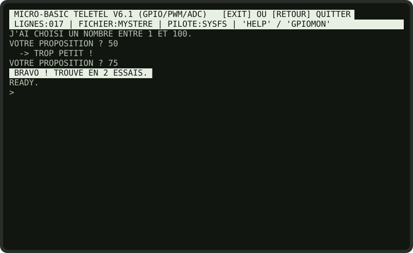<br><sub><b>Fig. 6.1</b> — Une partie gagnée en 6 essais, en coupant à chaque fois l'intervalle en deux.</sub></p>

**Comment ça marche.** `S` est le nombre secret, `E` le compteur d'essais. Les lignes 60 à 120 forment une boucle : la ligne 120 renvoie à la ligne 60 tant que le nombre n'est pas trouvé ; la ligne 90 en sort par un saut vers la ligne 130. Le point-virgule de la ligne 60 garde le curseur sur la ligne, si bien que le `? ` de l'`INPUT` s'affiche juste après la question.

**À vous de jouer.**
1. Limitez la partie à 7 essais : `IF E GE 7 THEN GOTO 300`, avec un message de défaite en 300.
2. Faites jouer l'ordinateur : c'est vous qui choisissez le nombre, il propose, vous répondez 1 (trop petit) ou 2 (trop grand). Indice : il retient l'intervalle encore possible dans deux variables, `BAS` et `HAUT`, et propose toujours le milieu.

### 6.2 LES TABLES DE MULTIPLICATION ★

*Deux boucles `FOR` imbriquées, alignement des colonnes.*

```basic
10 REM *** TABLES DE MULTIPLICATION ***
20 CLS
30 PRINT "       TABLE DE PYTHAGORE"
40 PRINT ""
50 FOR L = 1 TO 9
60 FOR C = 1 TO 9
70 P = L * C
80 IF P LT 10 THEN PRINT " " ;
90 PRINT "  " ; P ;
100 NEXT C
110 PRINT ""
120 NEXT L
```

<p align="center">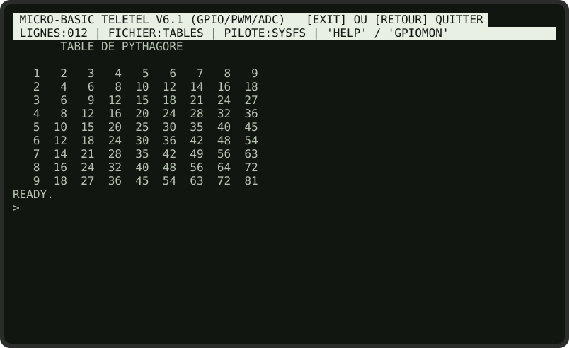<br><sub><b>Fig. 6.2</b> — La table de Pythagore.</sub></p>

**Comment ça marche.** La boucle `L` (lignes) contient la boucle `C` (colonnes) : pour chaque valeur de `L`, `C` parcourt 1 à 9. Les `PRINT` de la boucle intérieure finissent par un point-virgule pour rester sur la même ligne ; le `PRINT ""` de la ligne 110 passe à la ligne suivante. La ligne 80 ajoute un espace devant les nombres d'un seul chiffre, pour que les colonnes restent alignées.

**À vous de jouer.** Affichez la table en vidéo inverse quand `L` est égal à `C` (la diagonale des carrés).

### 6.3 LE COMPTE À REBOURS ★

*`WHILE`…`WEND`, `LOCATE`, `PAUSE`.*

```basic
10 REM *** COMPTE A REBOURS (WHILE...WEND) ***
20 CLS
30 N = 10
40 WHILE N GT 0
50 LOCATE 36, 12
60 PRINT "T - " ; N ; "  " ;
70 BEEP
80 PAUSE 1
90 N = N - 1
100 WEND
110 LOCATE 33, 12
120 INVERT
130 PRINT "  DECOLLAGE !  " ;
140 NORMAL
150 LOCATE 1, 20
```

<p align="center">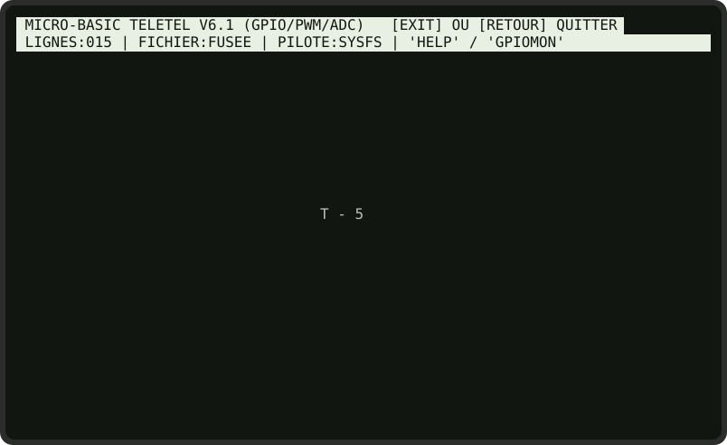<br><sub><b>Fig. 6.3</b> — Le compte à rebours en cours.</sub></p>

**Comment ça marche.** Le compteur est toujours réécrit au même endroit (ligne 50) : c'est l'animation la plus simple qui soit. Les deux espaces après `N` (ligne 60) effacent le second chiffre quand on passe de `10` à `9`. La ligne 150 place le curseur plus bas, pour que `READY.` ne s'affiche pas au milieu du dessin.

### 6.4 LES CADRES ★★

*Sous-programme avec « paramètres ».* Un même sous-programme trace des cadres de toutes tailles.

```basic
10 REM *** SOUS-PROGRAMME : CADRE ***
20 CLS
30 X = 4
40 Y = 5
50 L = 30
60 H = 7
70 GOSUB 1000
80 LOCATE X + 2, Y + 2
90 PRINT "FENETRE NUMERO 1" ;
100 X = 38
110 Y = 9
120 L = 38
130 H = 11
140 GOSUB 1000
150 LOCATE X + 2, Y + 2
160 PRINT "FENETRE NUMERO 2" ;
170 LOCATE 1, 22
180 END
1000 REM --- TRACE UN CADRE : X, Y, L, H ---
1010 LOCATE X, Y
1020 PRINT "+" ;
1030 FOR I = 2 TO L - 1
1040 PRINT "-" ;
1050 NEXT I
1060 PRINT "+" ;
1070 FOR J = Y + 1 TO Y + H - 2
1080 LOCATE X, J
1090 PRINT "|" ;
1100 LOCATE X + L - 1, J
1110 PRINT "|" ;
1120 NEXT J
1130 LOCATE X, Y + H - 1
1140 PRINT "+" ;
1150 FOR I = 2 TO L - 1
1160 PRINT "-" ;
1170 NEXT I
1180 PRINT "+" ;
1190 RETURN
```

<p align="center">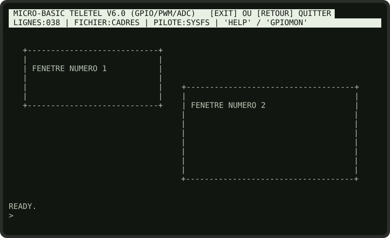<br><sub><b>Fig. 6.4</b> — Deux appels au même sous-programme.</sub></p>

**Comment ça marche.** Le BASIC n'a pas de paramètres de sous-programme : on convient que le sous-programme 1000 lit `X` et `Y` (coin supérieur gauche), `L` (largeur) et `H` (hauteur). Le programme principal fixe ces variables, puis appelle `GOSUB 1000`. Le `END` de la ligne 180 empêche le programme principal de « tomber » dans le sous-programme.

**À vous de jouer.** Ajoutez une variable `T` : si elle vaut 1, le sous-programme dessine le bord supérieur en vidéo inverse, comme les fenêtres du système.

### 6.5 LES STATISTIQUES DU DÉ ★★

*`RND`, comptage sans tableau, barres en vidéo inverse.*

```basic
10 REM *** STATISTIQUES : 120 LANCERS DE DE ***
20 CLS
30 PRINT "LANCEMENT DE 120 DES, PATIENCE..."
40 A = 0
50 B = 0
60 C = 0
70 D = 0
80 E = 0
90 F = 0
100 FOR I = 1 TO 120
110 R = RND(6)
120 IF R EQ 1 THEN A = A + 1
130 IF R EQ 2 THEN B = B + 1
140 IF R EQ 3 THEN C = C + 1
150 IF R EQ 4 THEN D = D + 1
160 IF R EQ 5 THEN E = E + 1
170 IF R EQ 6 THEN F = F + 1
180 NEXT I
190 PRINT ""
200 N = 1
210 V = A
220 GOSUB 500
230 N = 2
240 V = B
250 GOSUB 500
260 N = 3
270 V = C
280 GOSUB 500
290 N = 4
300 V = D
310 GOSUB 500
320 N = 5
330 V = E
340 GOSUB 500
350 N = 6
360 V = F
370 GOSUB 500
380 PRINT ""
390 PRINT "MOYENNE THEORIQUE : 20 PAR FACE"
400 END
500 REM --- BARRE HORIZONTALE : FACE N, VALEUR V ---
510 PRINT "FACE " ; N ; " : " ;
520 IF V LT 10 THEN PRINT " " ;
530 PRINT V ; " " ;
540 INVERT
550 FOR K = 1 TO V
560 PRINT " " ;
570 NEXT K
580 NORMAL
590 PRINT ""
600 RETURN
```

<p align="center">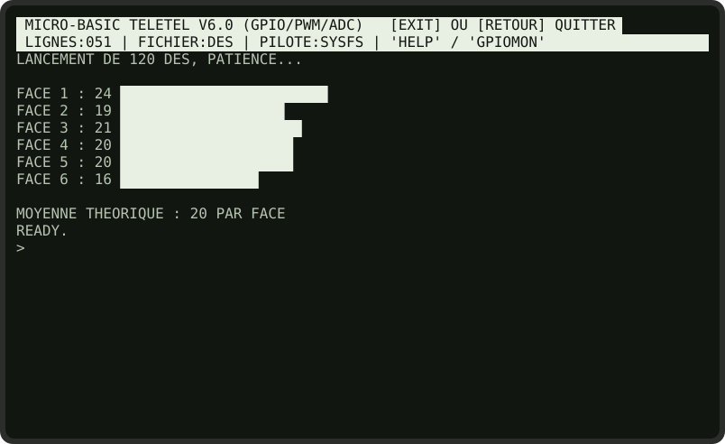<br><sub><b>Fig. 6.5</b> — Le hasard est bien réparti : chaque face sort environ 20 fois.</sub></p>

**Comment ça marche.** Faute de tableaux, chaque face a sa propre variable, de `A` à `F`. Les lignes 120 à 170 aiguillent chaque tirage vers la bonne variable. L'affichage passe par un sous-programme qui dessine une barre de `V` espaces en vidéo inverse.

**Le temps qui passe.** Ce programme exécute environ 1 000 lignes pour ses 120 lancers : comptez quelques secondes (§ 5.4). C'est pour cela que l'on se contente de 120 lancers et non de 10 000.

**À vous de jouer.** Lancez deux dés et comptez les sommes de 2 à 12. Que remarquez-vous ? (Il vous faudra onze variables : prenez des noms de deux lettres.)

### 6.6 L'OSCILLOSCOPE ★★

*Trigonométrie et tracé point par point.*

```basic
10 REM *** OSCILLOSCOPE SINUS / COSINUS ***
20 CLS
30 LOCATE 24, 3
40 INVERT
50 PRINT " OSCILLOSCOPE TELEMATIQUE 80 COLONNES " ;
60 NORMAL
70 FOR X = 2 TO 78
80 LOCATE X, 14
90 PRINT "-" ;
100 NEXT X
110 FOR X = 2 TO 78
120 A = X / 6
130 Y = 14 - INT(SIN(A) * 8)
140 C = 14 - INT(COS(A) * 8)
150 LOCATE X, C
160 PRINT "." ;
170 LOCATE X, Y
180 PRINT "*" ;
190 NEXT X
200 LOCATE 2, 23
210 PRINT "* = SINUS    . = COSINUS" ;
220 END
```

<p align="center">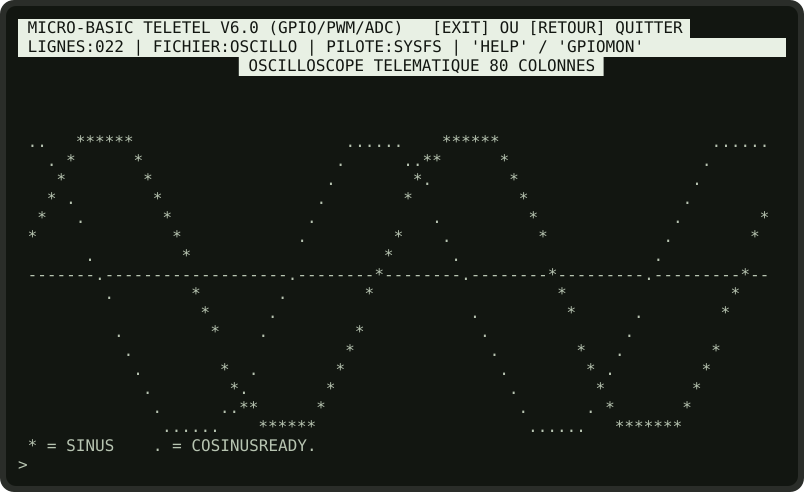<br><sub><b>Fig. 6.6</b> — Sinus et cosinus sur 77 colonnes.</sub></p>

**Comment ça marche.** Pour chaque colonne `X`, la ligne 120 calcule un angle `A`, et les lignes 130 et 140 transforment `SIN(A)` et `COS(A)`, compris entre -1 et 1, en numéros de ligne compris entre 6 et 22, centrés sur l'axe de la ligne 14. Sur l'écran, les lignes sont numérotées **vers le bas**, d'où le signe moins : une valeur positive doit monter.

**À vous de jouer.** Changez le diviseur de la ligne 120 (`X / 3`, `X / 12`) pour faire varier la fréquence, ou le multiplicateur `8` pour l'amplitude. Tracez `SIN(A) * COS(A / 4)`.

### 6.7 LA BALLE REBONDISSANTE ★★

*Animation sans clignotement.*

```basic
10 REM *** BALLE REBONDISSANTE ***
20 CLS
30 X = 40
40 Y = 12
50 DX = 1
60 DY = 1
70 LOCATE 22, 3
80 INVERT
90 PRINT " BALLE REBONDISSANTE - [RETOUR] = STOP " ;
100 NORMAL
110 LOCATE X, Y
120 PRINT " " ;
130 X = X + DX
140 Y = Y + DY
150 IF X LE 2 THEN DX = 1
160 IF X GE 79 THEN DX = -1
170 IF Y LE 5 THEN DY = 1
180 IF Y GE 23 THEN DY = -1
190 LOCATE X, Y
200 PRINT "O" ;
210 PAUSE 0.03
220 GOTO 110
```

<p align="center">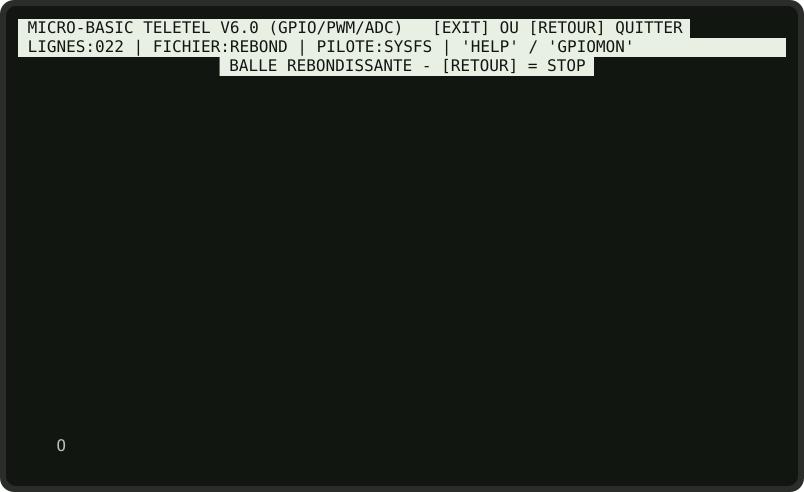<br><sub><b>Fig. 6.7</b> — La balle en mouvement.</sub></p>

**Comment ça marche.** `DX` et `DY` sont les composantes de la vitesse : +1 ou -1 sur chaque axe. Lorsque la balle atteint un bord, la composante correspondante change de signe : c'est le rebond. Chaque image n'envoie au Minitel qu'une vingtaine d'octets : l'effacement de l'ancienne balle (lignes 110-120) et le dessin de la nouvelle (lignes 190-200).

> **Sans symboles.** Les tests des lignes 150 à 180 utilisent `LE` et `GE` ; `<=` et `>=` donneraient le même résultat.

**À vous de jouer.** Faites émettre un `BEEP` à chaque rebond. Laissez une traînée en ne l'effaçant que tous les deux pas.

### 6.8 LE BANC DE PUISSANCE ★★

*Simuler un `STEP`, jauge en vidéo inverse.* Une montée en régime de 1 000 à 6 500 tr/min, avec la puissance calculée d'après le couple.

```basic
10 REM *** BANC DE PUISSANCE ***
20 CLS
30 PRINT "COUPLE MOTEUR MOYEN EN NM (EX: 240) " ;
40 INPUT C
50 CLS
60 LOCATE 22, 5
70 INVERT
80 PRINT " BANC D'ESSAI MOTEUR MAGIS CLUB " ;
90 NORMAL
100 FOR R = 1000 TO 6500
110 P = INT((C * R) / 7024)
120 B = INT(R / 100)
130 LOCATE 5, 9
140 PRINT "REGIME : " ; R ; " TR/MIN  |  PUISSANCE : " ; P ; " CH    "
150 LOCATE 5, 11
160 INVERT
170 FOR I = 1 TO B
180 PRINT " " ;
190 NEXT I
200 NORMAL
210 R = R + 499
220 NEXT R
230 BEEP
240 LOCATE 5, 14
250 PRINT "PUISSANCE MAXI : " ; P ; " CH A 6500 TR/MIN"
260 END
```

<p align="center">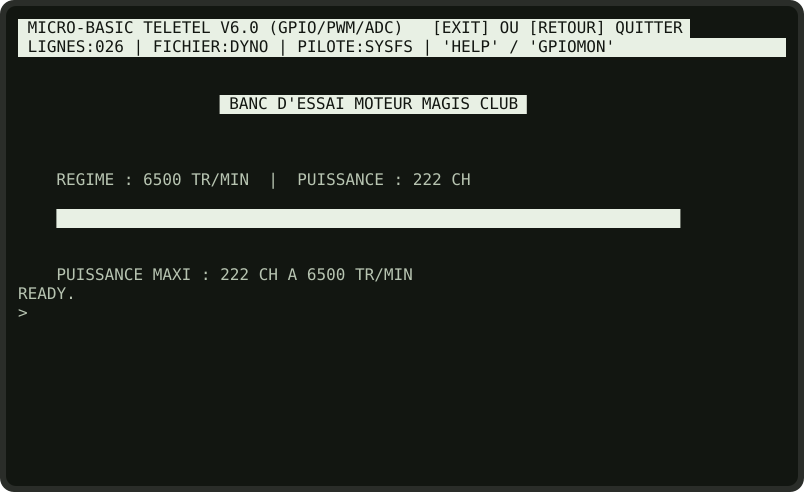<br><sub><b>Fig. 6.8</b> — Fin de l'essai pour un couple de 240 N·m.</sub></p>

**Comment ça marche.** La puissance en chevaux vaut couple × régime / 7 024 (ligne 110). La boucle `FOR R` n'a pas de `STEP` : la ligne 210 ajoute 499, et le `NEXT` ajoute 1, ce qui fait avancer `R` de 500 en 500. La jauge (lignes 160 à 200) est une rangée d'espaces en vidéo inverse dont la longueur suit le régime.

### 6.9 SLALOM ★★★

*Un vrai jeu : `MKEY()`, défilement de l'écran, collisions.* Pilotez votre voiture (`A`) sur une route sinueuse avec `Q` et `D` (ou les flèches). Ne touchez pas les bords !

```basic
10 REM *** SLALOM : JEU D'ADRESSE ***
20 CLS
30 P = 40
40 Q = 40
50 R = 30
60 W = 20
70 S = 0
100 D = RND(3) - 2
110 R = R + D
120 IF R LT 2 THEN R = 2
130 IF R GT 56 THEN R = 56
140 K = MKEY()
150 IF K EQ 202 THEN P = P - 2
160 IF K EQ 203 THEN P = P + 2
170 LOCATE R, 24
180 PRINT "#" ;
190 LOCATE R + W, 24
200 PRINT "#"
210 LOCATE Q, 22
220 PRINT " " ;
230 LOCATE P, 23
240 INVERT
250 PRINT "A" ;
260 NORMAL
270 Q = P
280 IF P LE R THEN GOTO 400
290 IF P GE R + W THEN GOTO 400
300 S = S + 1
310 GOTO 100
400 BEEP
410 LOCATE 30, 12
420 INVERT
430 PRINT " SORTIE DE ROUTE ! " ;
440 LOCATE 30, 13
450 PRINT " DISTANCE : " ; S ; " METRES " ;
460 NORMAL
470 LOCATE 1, 20
480 END
```

<p align="center">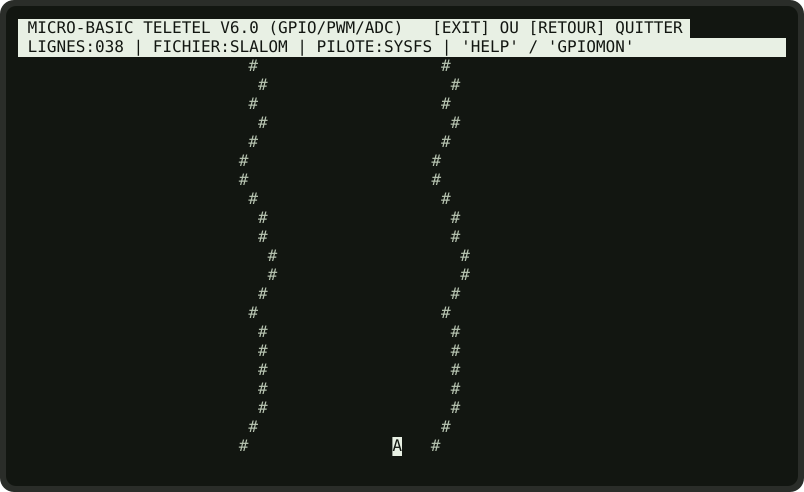<br><sub><b>Fig. 6.9</b> — La route défile vers le haut ; la voiture est en bas, en vidéo inverse.</sub></p>

**Comment ça marche.** C'est le programme le plus astucieux du recueil.

* **La route** est représentée par son bord gauche `R` et sa largeur `W`. À chaque tour, `R` varie de -1, 0 ou +1 au hasard (lignes 100-130).
* **Le défilement** : les deux bords sont dessinés sur la ligne 24, et le `PRINT "#"` de la ligne 200, **sans point-virgule**, passe à la ligne alors que le curseur est déjà tout en bas. Toute la zone de travail monte donc d'un cran, et la route semble avancer vers le haut (§ 4.2). Un seul caractère de passage à la ligne fait défiler tout l'écran : aucune ligne de route n'est jamais redessinée.
* **La voiture** reste sur la ligne 23, mais le défilement l'emporte vers la ligne 22 : la ligne 210 efface donc l'ancienne voiture en ligne 22, à l'ancienne position `Q`, avant de la redessiner en ligne 23.
* **La collision** : après le défilement, la ligne de route qui vient d'être dessinée se trouve justement en ligne 23, celle de la voiture. Il suffit de comparer `P` à `R` et à `R + W` (lignes 280-290).

**À vous de jouer.**
1. Rétrécissez la route au fil du temps : `IF S MOD 100 EQ 0 THEN W = W - 1`.
2. Ajoutez des obstacles : de temps en temps (`IF RND(20) EQ 1`), dessinez un `*` au milieu de la route.
3. Affichez le score en direct sur la ligne 2, à côté de la barre d'état.

<div style="page-break-after: always;"></div>

## CHAPITRE 7 : ENTRÉES-SORTIES MATÉRIELLES (GPIO)

Le Raspberry Pi possède un connecteur de 40 broches, dont 26 sont des **GPIO** (*General Purpose Input/Output*) : des broches que le programme peut lire (bouton, capteur) ou commander (LED, relais, buzzer). Le MICRO-BASIC les rend accessibles en une instruction.

### 7.1 Le connecteur et la numérotation

Le BASIC désigne les broches par leur **numéro BCM** (le numéro du signal dans la puce), et non par leur position physique sur le connecteur.

```text
                     CONNECTEUR GPIO DU RASPBERRY PI (40 broches)
                     vu de dessus, port USB/Ethernet vers le bas

         3,3 V  [ 1] [ 2]  5 V
  GPIO  2 (SDA) [ 3] [ 4]  5 V
  GPIO  3 (SCL) [ 5] [ 6]  Masse
  GPIO  4       [ 7] [ 8]  GPIO 14 (TXD)  <- protegee
         Masse  [ 9] [10]  GPIO 15 (RXD)  <- protegee
  GPIO 17       [11] [12]  GPIO 18 (PWM)
  GPIO 27       [13] [14]  Masse
  GPIO 22       [15] [16]  GPIO 23
         3,3 V  [17] [18]  GPIO 24
  GPIO 10       [19] [20]  Masse
  GPIO  9       [21] [22]  GPIO 25
  GPIO 11       [23] [24]  GPIO  8
         Masse  [25] [26]  GPIO  7
  (ID EEPROM)   [27] [28]  (ID EEPROM)
  GPIO  5       [29] [30]  Masse
  GPIO  6       [31] [32]  GPIO 12
  GPIO 13       [33] [34]  Masse
  GPIO 19       [35] [36]  GPIO 16
  GPIO 26       [37] [38]  GPIO 20
         Masse  [39] [40]  GPIO 21
```

* Les broches commandables vont de **GPIO 2 à GPIO 27**.
* **GPIO 14 et 15** (la liaison série du Pi) sont **protégées** : le BASIC refuse de les modifier, pour ne jamais couper une liaison série.

> **Sécurité électrique.** Les GPIO fonctionnent en **3,3 V**. N'y appliquez **jamais 5 V** : la puce serait détruite. Une broche ne fournit que quelques milliampères : une LED se branche **toujours avec une résistance en série** (330 Ω environ), et un relais ou un moteur passe obligatoirement par un transistor ou un module de commande.

### 7.2 Les pilotes

Au démarrage, la barre d'état indique le pilote détecté (`PILOTE:…`) :

| Pilote | Quand | Mécanisme |
| :----- | :---- | :-------- |
| `PINCTRL` | Raspberry Pi OS récent | Commande `pinctrl` |
| `RASPI-GPIO` | Raspberry Pi OS plus ancien | Commande `raspi-gpio` |
| `SYSFS` | Sinon (et en émulation PC) | Fichiers `/sys/class/gpio/…` |

Indépendamment, si le démon **`pigpiod`** est actif, le BASIC s'en sert pour les signaux PWM, avec une précision bien meilleure (§ 7.4).

### 7.3 Les sorties et les entrées logiques

| Instruction | Effet | Exemple |
| :---------- | :---- | :------ |
| `PINMODE p, mode` | Règle la broche `p` : `OUT` (sortie), `IN` (entrée), `PU` (entrée avec rappel au 3,3 V), `PD` (entrée avec rappel à la masse). Les nombres `1`, `2` et `3` équivalent à `OUT`, `PU` et `PD`. | `PINMODE 27, PU` |
| `OUT p, v` | Met la broche à 1 (3,3 V) si `v` ≠ 0, à 0 (masse) sinon. Passe la broche en sortie si nécessaire. Synonymes : `POKE`, `GPIOOUT`. | `OUT 17, 1` |
| `TOGGLE p` | Inverse l'état de la broche. | `TOGGLE 17` |
| `PULSE p, durée` | Met la broche à 1 pendant `durée` secondes (de 0,01 à 10), puis à 0. Le programme attend pendant l'impulsion. | `PULSE 17, 0.5` |
| `IN(p)` ou `IN p` | **Fonction** : état de la broche, 0 ou 1. Synonyme : `PEEK`. | `B = IN 27` |

**Programme : la LED clignotante.** Une LED (avec sa résistance) entre GPIO 17 et la masse.

```basic
10 REM *** LED CLIGNOTANTE SUR GPIO 17 ***
20 CLS
30 PINMODE 17, OUT
40 PRINT "LED SUR GPIO 17 - [RETOUR] POUR ARRETER"
50 TOGGLE 17
60 PAUSE 0.5
70 GOTO 50
```

**Programme : le bouton.** Un bouton-poussoir entre GPIO 27 et la masse ; la LED sur GPIO 17. Grâce au mode `PU`, la broche lit **1 au repos** et **0 quand on appuie**.

```basic
10 REM *** BOUTON (GPIO 27) -> LED (GPIO 17) ***
20 CLS
30 PINMODE 27, PU
40 PINMODE 17, OUT
50 N = 0
60 A = 1
70 B = IN 27
80 IF B EQ 0 AND A EQ 1 THEN GOSUB 200
90 IF B EQ 0 THEN OUT 17, 1 ELSE OUT 17, 0
100 A = B
110 GOTO 70
200 N = N + 1
210 LOCATE 10, 10
220 PRINT "APPUIS DETECTES : " ; N ; "   " ;
230 RETURN
```

**Comment ça marche.** `B` est l'état actuel du bouton, `A` l'état au tour précédent. Un appui est compté **au moment où le bouton passe de 1 à 0** (ligne 80) : on parle de **détection de front**. Sans cette précaution, un appui tenu une seconde serait compté des dizaines de fois.

### 7.4 PWM et fréquences

Une broche numérique ne connaît que 0 et 1. La **PWM** (*modulation de largeur d'impulsion*) la fait basculer très vite, en réglant la proportion du temps passé à 1 : le **rapport cyclique**. À 25 %, une LED semble briller au quart de sa puissance ; un moteur tourne au quart de sa vitesse.

| Instruction | Effet |
| :---------- | :---- |
| `PWM p, r` | Signal PWM de rapport cyclique `r` % (0 à 100) sur la broche `p`, à la fréquence courante de la broche (100 Hz par défaut). `PWM p, 0` coupe le signal, `PWM p, 100` met la broche à 1 en permanence. |
| `FREQ p, hz` | Signal carré de `hz` hertz (1 à 2 000) sur la broche `p`, au rapport cyclique courant (50 % par défaut) : pour un buzzer, ou pour cadencer un circuit. `FREQ p, 0` coupe le signal. |
| `PWMSTOP` | Coupe tous les signaux PWM et FREQ en cours. |

Le signal continue **en tâche de fond**, même pendant que le programme fait autre chose. `NEW`, `LOAD` et `EXIT` coupent tous les signaux.

> **Précision.** Avec le démon `pigpiod` (`sudo systemctl enable --now pigpiod`), les signaux sont produits par le matériel du Pi, avec une précision de l'ordre de la microseconde. Sans lui, le BASIC lance une **boucle logicielle** qui bascule la broche à coups de commandes système : assez bien pour faire varier une LED ou un moteur, mais trop irrégulier pour un servomoteur ou une note de musique juste.

**Programme : la LED qui respire.** Une LED sur GPIO 18 s'allume et s'éteint en douceur.

```basic
10 REM *** LED QUI RESPIRE (PWM SUR GPIO 18) ***
20 CLS
30 FOR I = 0 TO 20
40 PWM 18, I * 5
50 PAUSE 0.05
60 NEXT I
70 FOR I = 0 TO 20
80 PWM 18, 100 - I * 5
90 PAUSE 0.05
100 NEXT I
110 GOTO 30
```

### 7.5 Les mesures : entrées analogiques et température

Le Raspberry Pi n'a pas de convertisseur analogique-numérique. Pour lire une tension (potentiomètre, capteur de lumière, de température…), on lui adjoint un **ADC** externe (par exemple un circuit MCP3008 ou ADS1115).

| Fonction | Effet |
| :------- | :---- |
| `ADC(c)` ou `ADC c` | Valeur du canal analogique `c` (0 à 7). Synonyme : `ANALOG`. |
| `SETADC c, v` | Fixe la valeur **simulée** du canal `c`, pour mettre un programme au point sans le matériel. |
| `TEMP` | Température du processeur du Raspberry Pi, en °C, au dixième. |

Pour lire un canal, l'interpréteur essaie trois sources, dans l'ordre :

1. un vrai convertisseur déclaré auprès de Linux : fichier `/sys/bus/iio/devices/iio:device0/in_voltageC_raw` ;
2. un fichier texte `/tmp/adcC`, qu'un autre programme peut remplir (par exemple un script qui reçoit les mesures d'un microcontrôleur) ;
3. la valeur simulée, fixée par `SETADC`. Au démarrage : 512 sur le canal 0, 256 sur le 1, 0 sur le 2 et 1023 sur le 3.

**Programme : la jauge.** Un potentiomètre sur le canal 0 d'un convertisseur 10 bits (valeurs de 0 à 1023).

```basic
10 REM *** JAUGE ANALOGIQUE (ADC CANAL 0) ***
20 CLS
30 LOCATE 20, 5
40 PRINT "POTENTIOMETRE SUR ADC 0 - [RETOUR] = STOP" ;
50 V = ADC 0
60 LOCATE 5, 10
70 PRINT "VALEUR : " ; V ; "     " ;
80 LOCATE 5, 12
90 PRINT "[" ;
100 INVERT
110 FOR I = 1 TO INT(V / 16)
120 PRINT " " ;
130 NEXT I
140 NORMAL
150 FOR I = INT(V / 16) TO 63
160 PRINT "." ;
170 NEXT I
180 PRINT "]" ;
190 PAUSE 0.5
200 GOTO 50
```

<p align="center">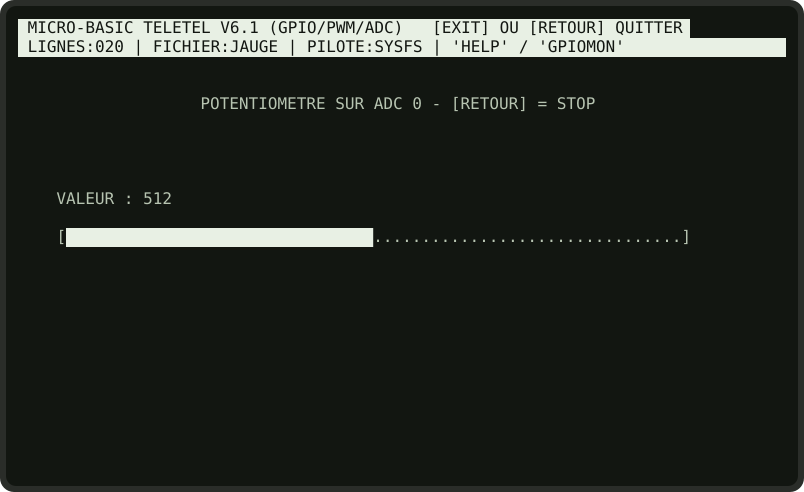<br><sub><b>Fig. 7.1</b> — La jauge, ici avec la valeur simulée par défaut (512, soit la moitié).</sub></p>

**Programme : le thermostat.** Un ventilateur, commandé par un transistor sur GPIO 23, se met en marche au-delà de 60 °C.

```basic
10 REM *** THERMOSTAT : VENTILATEUR SUR GPIO 23 ***
20 CLS
30 PINMODE 23, OUT
40 T = TEMP
50 LOCATE 5, 8
60 PRINT "TEMPERATURE PROCESSEUR : " ; T ; " C   " ;
70 LOCATE 5, 10
80 IF T GT 60 THEN GOSUB 200 ELSE GOSUB 300
90 PAUSE 5
100 GOTO 40
200 OUT 23, 1
210 PRINT "VENTILATEUR : MARCHE" ;
220 RETURN
300 OUT 23, 0
310 PRINT "VENTILATEUR : ARRET " ;
320 RETURN
```

**À vous de jouer.** Ajoutez une **hystérésis** : démarrage au-dessus de 60 °C, arrêt seulement en dessous de 55 °C, pour que le ventilateur ne batte pas sans cesse autour du seuil.

### 7.6 Le moniteur `GPIOMON`

Tapez `GPIOMON` à l'invite : un tableau de bord affiche, rafraîchi chaque seconde, l'état de 24 broches, les signaux PWM actifs, les quatre premiers canaux analogiques et la température.

<p align="center">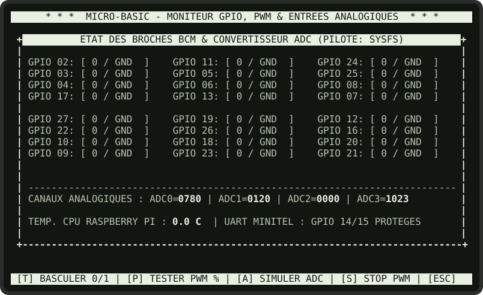<br><sub><b>Fig. 7.2</b> — Le moniteur, après <code>SETADC 0 780</code> et <code>SETADC 1 120</code> (émulation PC : toutes les broches lisent 0).</sub></p>

| Touche | Effet |
| :----- | :---- |
| `T` | Inverser l'état d'une broche (son numéro est demandé). |
| `P` | Lancer un signal PWM de test (broche et pourcentage demandés, 100 Hz). |
| `A` | Simuler la valeur d'un canal analogique. |
| `S` | Couper tous les signaux PWM. |
| Espace | Rafraîchir immédiatement. |
| `[RETOUR]` | Revenir à l'invite. |

C'est l'outil idéal pour **vérifier un câblage** avant d'écrire le programme : allumez la LED avec `T`, regardez si le bouton fait changer l'affichage.

<div style="page-break-after: always;"></div>

## CHAPITRE 8 : MESSAGES D'ERREUR

Une erreur arrête le programme et affiche le numéro de la ligne fautive. Les variables gardent leurs valeurs : examinez-les en mode direct.

| Message | Signification | Que faire |
| :------ | :------------ | :-------- |
| `SYNTAX ERROR IN n` | L'instruction de la ligne `n` n'est pas reconnue, il lui manque un élément, ou l'une de ses expressions est incorrecte (`2 + * 3`, parenthèse manquante, `(X GT 1) + 1`). | Vérifiez l'orthographe du mot-clé, la virgule de `LOCATE` ou de `OUT`, le `THEN` d'un `IF`, puis chaque expression de la ligne. |
| `SYNTAX ERROR` | Même chose, en mode direct. | |
| `UNDEFINED LINE x IN n` | `GOTO` ou `GOSUB` vers une ligne `x` qui n'existe pas. | Vérifiez le numéro ; `LIST` pour revoir le programme. |
| `NEXT WITHOUT FOR IN n` | `NEXT` sans `FOR` correspondant, ou avec une autre variable. | Le `NEXT` doit nommer la variable du `FOR` le plus récent encore ouvert. |
| `RETURN WITHOUT GOSUB IN n` | `RETURN` atteint sans `GOSUB`. | Souvent un `END` oublié avant les sous-programmes. |
| `WHILE WITHOUT WEND IN n` | Condition fausse, et le `WEND` correspondant est introuvable. | Ajoutez le `WEND`. |
| `WEND WITHOUT WHILE IN n` | `WEND` sans `WHILE` ouvert. | |
| `BREAK IN n` | Vous avez appuyé sur `[RETOUR]`. | Ce n'est pas une erreur. `RUN` pour relancer. |
| `PROGRAM STOPPED AT LINE n` | Instruction `STOP` atteinte. | |
| `LINE NOT FOUND` | `EDIT` d'une ligne qui n'existe pas. | |
| `FILE NOT FOUND` | `LOAD` d'un fichier absent. | Vérifiez le nom avec `DIR` ; attention aux majuscules (§ 1.5). |

<table>
<tr>
<td align="center">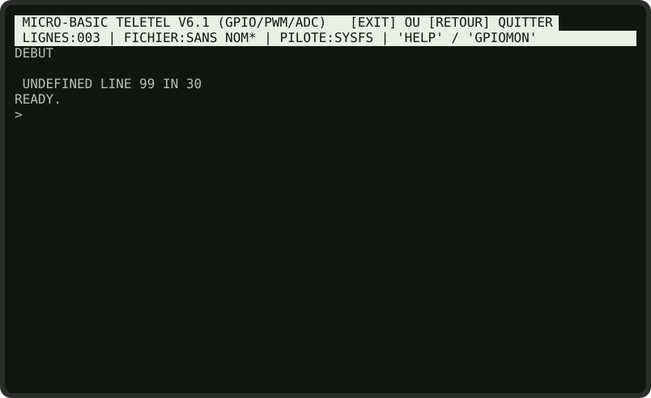<br><sub><b>Fig. 8.1</b> — <code>30 GOTO 99</code></sub></td>
<td align="center">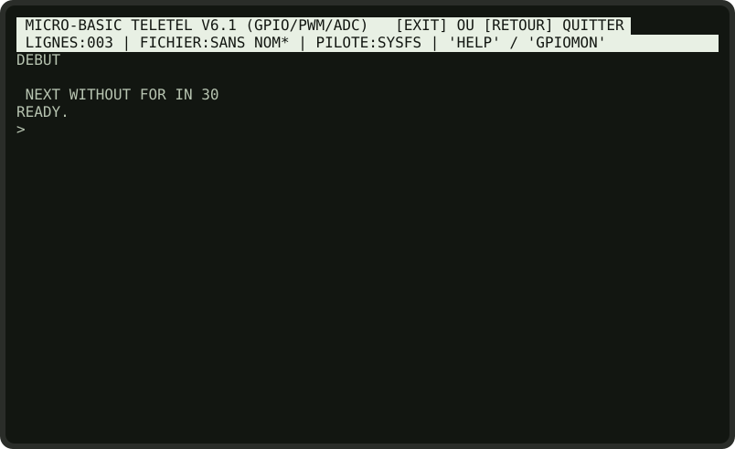<br><sub><b>Fig. 8.2</b> — <code>30 NEXT J</code> sans <code>FOR</code></sub></td>
</tr>
<tr>
<td align="center" colspan="2">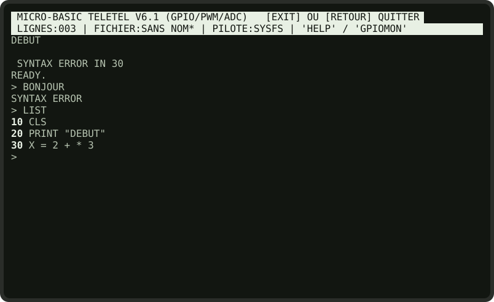<br><sub><b>Fig. 8.3</b> — Une expression incorrecte en ligne 30, puis une instruction inconnue en mode direct</sub></td>
</tr>
</table>

> **Un programme qui se trompe sans message ?** Si le résultat est faux sans qu'aucune erreur ne s'affiche, affichez les valeurs intermédiaires avec des `PRINT` provisoires, ou placez un `STOP` et inspectez les variables en mode direct. Pensez au piège des variables qui gardent leur valeur d'un `RUN` à l'autre (§ 2.2) et à celui de `AND` / `OR` entre de simples nombres (§ 2.5).

<div style="page-break-after: always;"></div>

## ANNEXE A : CARTE DE RÉFÉRENCE RAPIDE

```text
+==============================================================================+
|                   MICRO-BASIC TELETEL V6.1  -  CARTE DE REFERENCE            |
+==============================================================================+
| COMMANDES        RUN  LIST  NEW  CLEAR(=NEW!)  EDIT n  DIR                   |
|                  SAVE NOM  LOAD NOM  HELP  GPIOMON  EXIT                     |
| EDITION          n instruction   (ajoute / remplace)     n seul  (supprime)  |
+------------------------------------------------------------------------------+
| AFFICHAGE        PRINT "TEXTE" ; expr ; ...   (; final = reste sur la ligne) |
|                  CLS   LOCATE x, y (x=1..80, y=1..24)   INVERT   NORMAL      |
| SON / TEMPS      BEEP          PAUSE secondes                                |
| CLAVIER          INPUT var     K = MKEY()                                    |
|                  MKEY : 0 rien  200 haut/Z  201 bas/S  202 gauche/Q          |
|                         203 droite/D  13 ENVOI  27 RETOUR  sinon code ASCII  |
+------------------------------------------------------------------------------+
| VARIABLES        lettres seulement (X, DX, SCORE), nombres seulement, 0 au   |
|                  depart, conservees entre deux RUN.   X = expr   LET   X EQ  |
+------------------------------------------------------------------------------+
| DEROULEMENT      GOTO n        GOSUB n ... RETURN       END      STOP    REM |
|                  IF cond THEN instr [ELSE instr]                             |
|                  FOR v = a TO b ... NEXT v   (pas de STEP, au moins 1 tour)  |
|                  WHILE cond ... WEND                                         |
+------------------------------------------------------------------------------+
| OPERATEURS       +  -  *  /  ^  MOD     PLUS MOINS FOIS MUL DIV              |
| COMPARAISONS     =  <  >  <=  >=  <>      EQ  LT  GT  LE  GE  NEQ            |
| LOGIQUE          AND  OR  NOT   (entre des comparaisons uniquement)          |
| FONCTIONS        RND(n)  INT  ABS  SQR  SIN  COS  TAN  EXP  LOG  PI          |
+------------------------------------------------------------------------------+
| GPIO (BCM 2..27) PINMODE p, OUT|IN|PU|PD    OUT p, v    TOGGLE p             |
|                  PULSE p, s    IN(p)    PWM p, %    FREQ p, hz    PWMSTOP    |
| MESURES          ADC(c)   SETADC c, v   TEMP                                 |
+------------------------------------------------------------------------------+
| CONSEILS         Commencer par CLS.  Espaces autour des operateurs.          |
|                  Initialiser les variables.  Sauvegarder souvent.            |
+==============================================================================+
```

## ANNEXE B : MOTS RÉSERVÉS

Ces mots ont un sens pour l'interpréteur. **Ne les employez pas comme noms de variables** : dans une expression, ils seraient pris pour l'opérateur ou la fonction, et le calcul serait faux sans prévenir.

```text
  ABS     ADC     ANALOG  AND     COS     DIV     EQ      EXP     FOIS
  GE      GT      IN      INT     LE      LOG     LT      MINUS   MKEY
  MOD     MOINS   MUL     NEQ     NOT     OR      PEEK    PI      PLUS
  RND     SIN     SQR     TAN     TEMP
```

Évitez aussi les noms d'instructions (`PRINT`, `FOR`, `TO`, `NEXT`, `IF`, `THEN`, `ELSE`, `GOTO`, `OUT`, `PWM`…), qui rendraient les lignes ambiguës.

## ANNEXE C : DIFFÉRENCES AVEC LES AUTRES BASIC

Pour qui a appris sur un Commodore 64, un Amstrad CPC, un Thomson MO5 ou en GW-BASIC :

| Vous avez l'habitude de… | En MICRO-BASIC |
| :----------------------- | :------------- |
| `A$ = "TEXTE"` | Pas de variables texte : le texte n'existe qu'entre guillemets dans `PRINT`. |
| `DIM T(10)` | Pas de tableaux : une variable par valeur (programme DÉS). |
| `10 PRINT A : PRINT B` | Une seule instruction par ligne. |
| `FOR I = 10 TO 0 STEP -2` | Pas de `STEP` : modifiez la variable dans la boucle. |
| `ON X GOTO 100, 200` | `GOTO 100 * X` (aiguillage calculé, § 5.5). |
| `IF X > 0 THEN 100` | `IF X > 0 THEN GOTO 100` |
| `PRINT A, B` (tabulation) | `PRINT A ; "   " ; B` |
| `DATA` / `READ` | N'existent pas : affectez les valeurs une à une. |
| `CLEAR` efface les variables | `CLEAR` efface **aussi le programme** (comme `NEW`). |
| `INKEY$` / `GET` | `MKEY()`, qui renvoie un code numérique. |
| `POKE` / `PEEK` en mémoire | `POKE` et `PEEK` pilotent les **broches GPIO** du Raspberry Pi. |

---

<div align="center">

```text
 ============================================================
     FIN DU MANUEL DE PROGRAMMATION MICRO-BASIC
     READY.
     > _
 ============================================================
```

</div>
